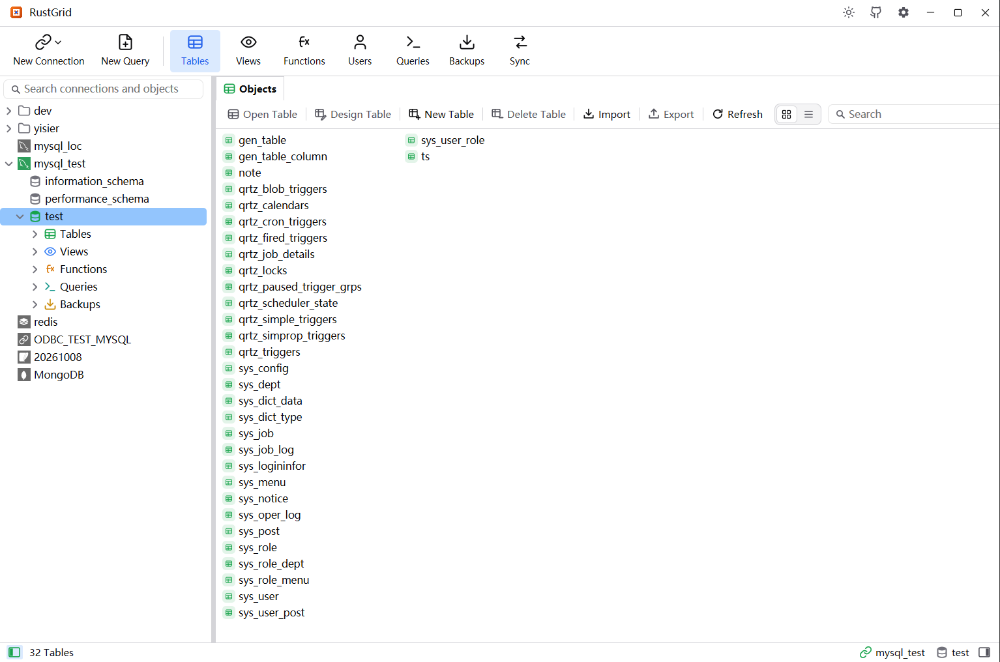
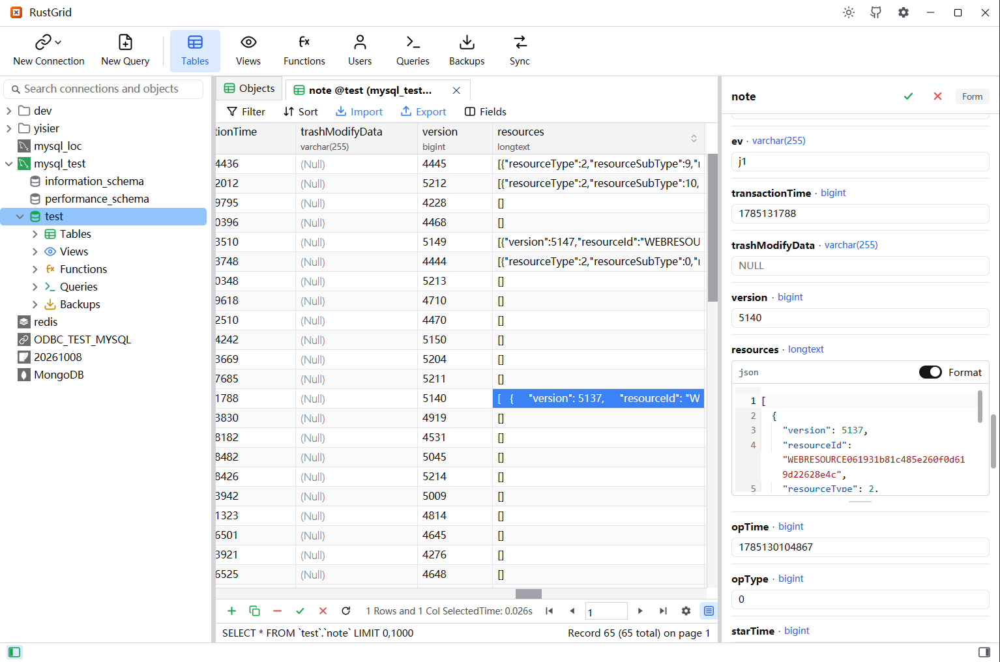
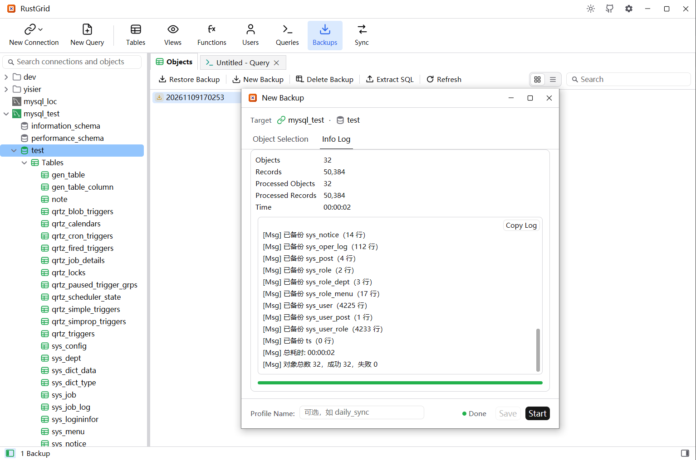
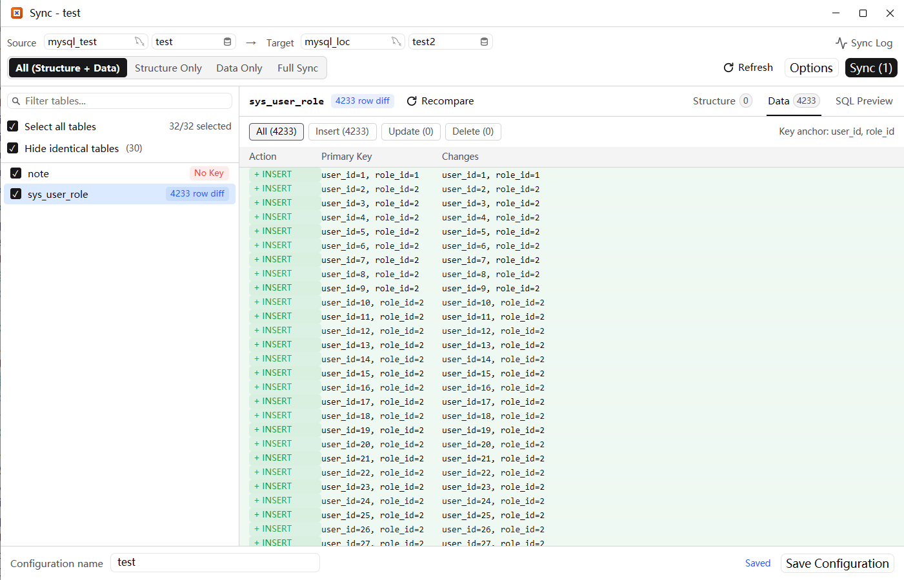

English | [简体中文](README_zh.md)

# RustGrid

> A Navicat-style SQL, Redis and MongoDB GUI built in Rust — native, lightweight, zero learning curve.

RustGrid is a cross-platform (Windows / macOS / Linux) database management tool for SQL, Redis and
MongoDB, built with **Rust + GPUI**. Its layout and interactions follow Navicat, so switching costs
nothing: the connection tree, object lists, toolbars and dialogs all behave the way you already
expect.

## Screenshots

<table>
  <tr>
    <td width="50%">
      
      <p align="center"><b>1.</b> Connection tree &amp; object list</p>
    </td>
    <td width="50%">
      
      <p align="center"><b>2.</b> Table data grid — paginated, in-place editing</p>
    </td>
  </tr>
  <tr>
    <td width="50%">
      
      <p align="center"><b>3.</b> Backup &amp; restore — the <code>.rgbak</code> container</p>
    </td>
    <td width="50%">
      
      <p align="center"><b>4.</b> SQL editor — highlighting, completion, results</p>
    </td>
  </tr>
</table>

## Highlights

- **Native, not a WebView** — GPU-rendered GPUI elements, no browser engine, a single binary.
- **Navicat-compatible** — the same connection tree, object panes, toolbars and dialogs.
- **Extensible drivers** — an engine-agnostic driver layer; new engines never touch the UI.
- **Apache-2.0** — free for commercial use.

## Supported databases

| Engine                 | Status                                      |
| ---------------------- | ------------------------------------------- |
| MySQL / MariaDB        | Supported                                   |
| SQLite                 | Supported                                   |
| SQL Server             | Supported                                   |
| PostgreSQL             | Supported                                   |
| Oracle                 | Supported                                   |
| Redis                  | Supported (standalone / Sentinel / Cluster) |
| MongoDB                | Supported (collections, documents, JSON commands) |
| StarRocks              | via MySQL compatibility mode                |
| DB2, Dameng, ...       | via generic ODBC                            |

## Features

- **Connections** — create / edit / delete, connect with a password prompt, nested groups with
  drag-and-drop, per-connection environment colours (red / yellow / green), TLS and SSH / SOCKS5 /
  HTTP tunnels, plus Import Connections (RustGrid, Navicat, DBX) and Export Connections. Passwords
  are encrypted on disk (XChaCha20-Poly1305) and never stored in a profile.
- **Databases & schemas** — enumerate databases and create, edit or delete them where the engine
  allows; SQL Server, PostgreSQL and Oracle show their schemas as a tree level.
- **Tables & views** — searchable object lists with sortable, resizable columns; a paginated data
  grid with in-place editing, Excel-like multi-range selection, copy / paste, sorting, a tree-shaped
  filter builder, field layout (hide / reorder), a selected-cell sum, and dropping / emptying /
  truncating / renaming a table.
- **Table designer** — every engine gets its own tabs and options: fields, indexes with per-column
  sort and prefix, foreign keys, unique keys, checks, exclusion constraints, rules, triggers,
  partitioning and comments, with a live SQL preview.
- **SQL editor** — syntax highlighting and smart completion, Beautify SQL, Explain, multi-statement
  runs on one session (a result tab per result set), and saved named queries.
- **Scripts & results** — Run SQL File and Dump SQL File from a database's menu; Export Results
  writes one result set, or several as worksheets in one `.xlsx` workbook.
- **Users & privileges** — account editors and privilege managers for the engines that have
  accounts: server and database scopes, roles, and a SQL preview of the script Save runs.
- **Sync** — compare a source and a target database, across engines too, and apply structure, data,
  both or a full table copy, with per-table status, row-level diffs, a SQL preview, a run log and
  saved configurations.
- **Backup & restore** — RustGrid's own `.rgbak` container (zstd-compressed), with object
  selection, saved configurations, restore and Extract SQL.
- **Import & export wizards** — Excel workbooks, CSV and TXT import with column mapping and
  automatic table creation; `.xlsx` / `.csv` / `.sql` / `.txt` export for a whole table or just the
  rows on screen.
- **Views & routines** — edit a view, function or procedure definition, preview a view, Explain its
  SELECT, and run a function or procedure.
- **Redis** — browse standalone, Sentinel and Cluster servers by namespace; every key opens on its
  own page (RAW / JSON for strings, editable tables for collections), the key list offers New Key,
  Set TTL, Rename and Delete, and the query editor completes Redis commands and keys.
- **MongoDB** — browse databases and collections, page and edit documents in the normal grid and
  row form (embedded documents open as JSON), and run JSON commands (`find`, `aggregate`, `count`,
  any `runCommand`) in query tabs.
- **Options & updates** — light / dark / system themes, English / 简体中文 / Русский, rebindable
  shortcuts, editor font / line numbers / word wrap / Ctrl + wheel zoom, session restore,
  single-click mode, grid display options and a built-in self-updater.

## Build from source

Prerequisite: Rust stable (edition 2024; the toolchain is pinned in `rust-toolchain.toml`).

```bash
git clone https://github.com/yisier/rustgrid.git
cd rustgrid
cargo run -p rustgrid-app
```

The produced binary is named `RustGrid`.

On Windows a linker and C compiler are required (for sqlx's `ring`). With MSVC Build Tools
installed the default toolchain works; otherwise use the GNU toolchain:

```powershell
$env:RUSTUP_TOOLCHAIN="stable-x86_64-pc-windows-gnu"
$env:CARGO_TARGET_X86_64_PC_WINDOWS_GNU_LINKER="gcc"
$env:CC="gcc"
cargo run -p rustgrid-app
```

## Project layout (Cargo workspace)

- `crates/rustgrid-core` — engine-agnostic domain: driver/connection traits and models.
- `crates/rustgrid-mysql` — MySQL and MariaDB drivers.
- `crates/rustgrid-sqlite` — SQLite driver.
- `crates/rustgrid-sqlserver` — SQL Server driver.
- `crates/rustgrid-postgresql` — PostgreSQL driver.
- `crates/rustgrid-oracle` — Oracle driver (Oracle's pure-Rust `oracledb` thin driver, no Instant
  Client).
- `crates/rustgrid-redis` — Redis driver (standalone / Sentinel / Cluster); see
  `docs/redis-driver.md`.
- `crates/rustgrid-mongodb` — MongoDB driver (collections as tables, documents as rows, JSON
  commands in the query tab); see `docs/mongodb-driver.md`.
- `crates/rustgrid-tunnel` — shared SSH / SOCKS5 / HTTP tunnel used by the network drivers.
- `crates/rustgrid-odbc` — generic ODBC driver (DB2, Dameng, ...).
- `crates/rustgrid-backup` — the `.rgbak` backup container.
- `crates/rustgrid-export` — table-data exporters (`.xlsx` / `.csv` / `.sql` / `.txt`).
- `crates/rustgrid-import` — Excel / CSV / TXT source readers.
- `crates/rustgrid-config` — versioned settings/profiles and encrypted secret storage.
- `crates/rustgrid-app` — the GPUI desktop application (binary `RustGrid`).

## Changelog

Every release and what changed in it: [`CHANGELOG.md`](CHANGELOG.md) ([简体中文](CHANGELOG_zh.md)).

## License

Licensed under the **Apache License, Version 2.0**. Commercial use is permitted. See the
[`LICENSE`](LICENSE) file for the full text.

## Status

Early and evolving quickly — features, UI and on-disk formats may change without notice.
