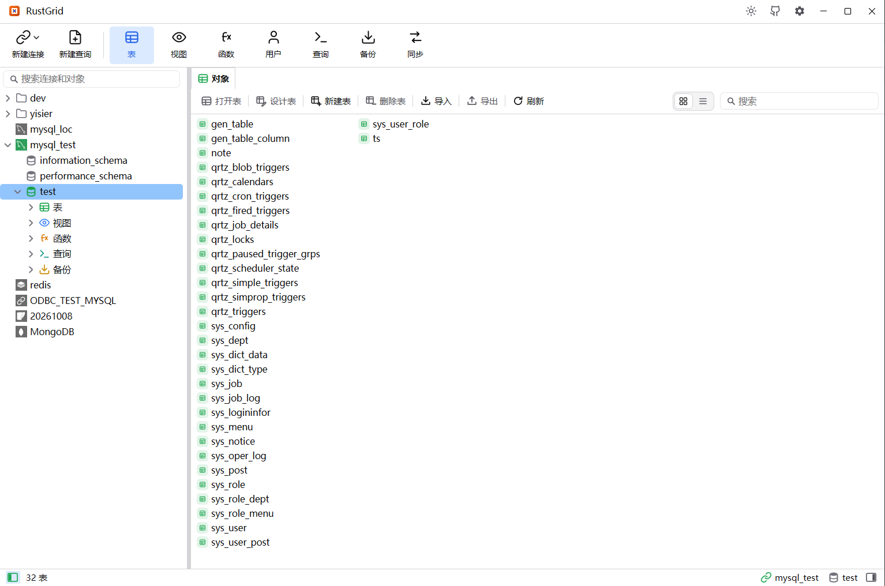
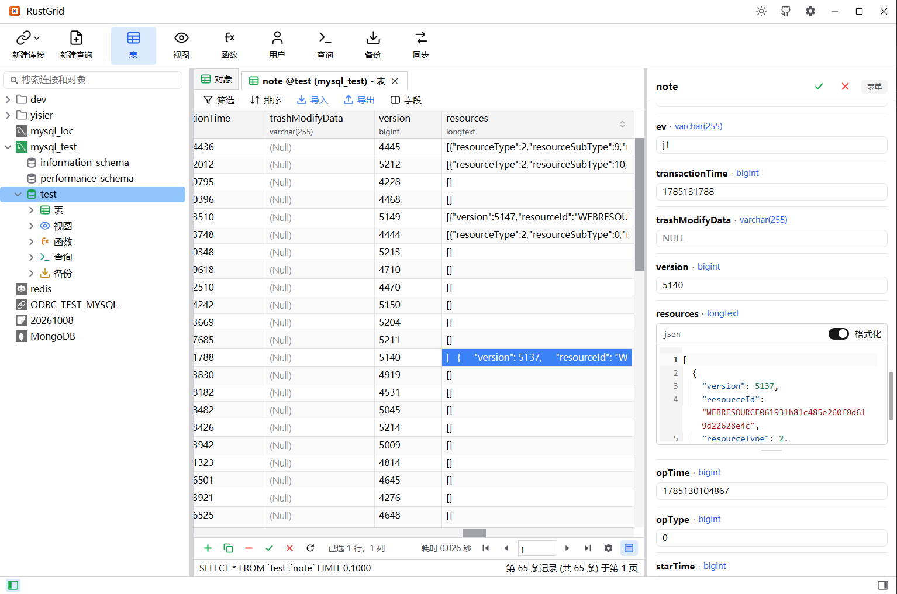
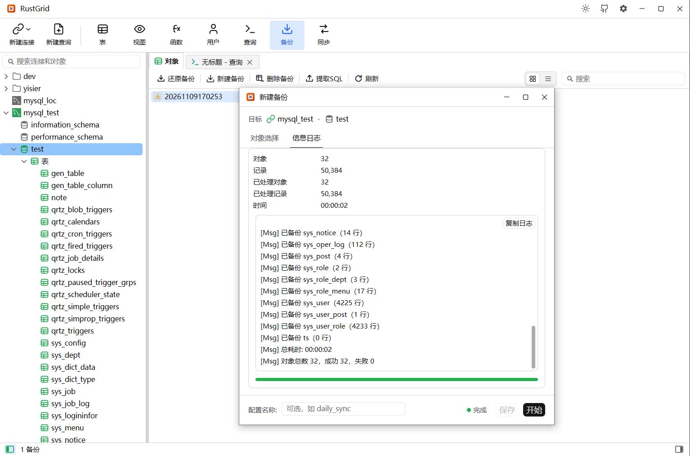
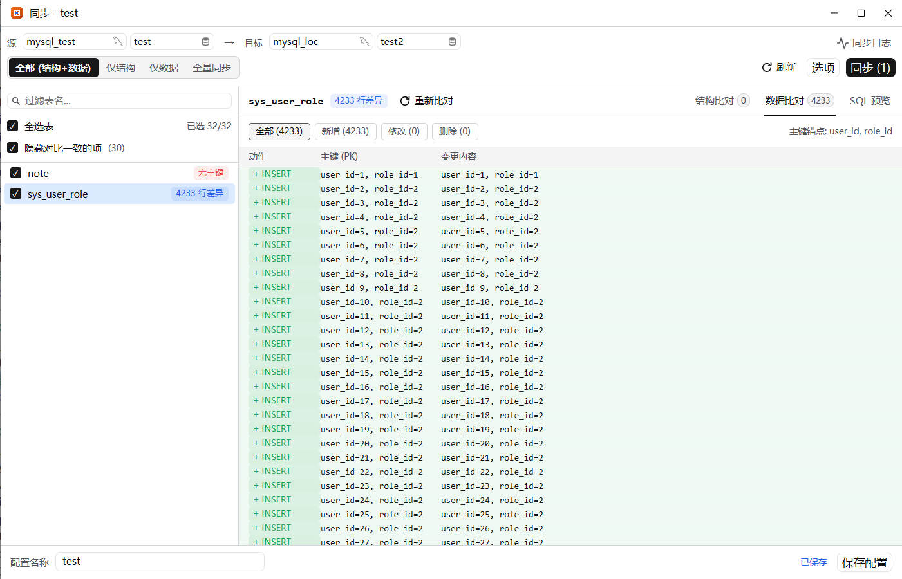

[English](README.md) | 简体中文

# RustGrid

> 用 Rust 打造的 Navicat 风格 SQL 与 Redis 管理工具 —— 原生、轻量、零学习成本。

RustGrid 是一款使用 **Rust + GPUI** 构建的跨平台（Windows / macOS / Linux）SQL 与 Redis
数据库管理工具。它的界面布局和交互习惯对齐 Navicat，连接树、对象列表、工具栏和弹窗都与你
熟悉的操作一致，迁移毫无成本。

## 界面预览

<table>
  <tr>
    <td width="50%">
      
      <p align="center"><b>1.</b> 连接树与对象列表</p>
    </td>
    <td width="50%">
      
      <p align="center"><b>2.</b> 表数据网格 —— 分页浏览，支持就地编辑</p>
    </td>
  </tr>
  <tr>
    <td width="50%">
      
      <p align="center"><b>3.</b> 备份与还原 —— <code>.rgbak</code> 容器</p>
    </td>
    <td width="50%">
      
      <p align="center"><b>4.</b> SQL 编辑器 —— 语法高亮、补全与结果</p>
    </td>
  </tr>
</table>

## 亮点

- **原生，而非 WebView** —— GPUI 元素由 GPU 直接渲染，不依赖浏览器引擎，单个二进制。
- **兼容 Navicat** —— 相同的连接树、对象面板、工具栏与弹窗。
- **可扩展的驱动层** —— 驱动与引擎解耦，新增数据库无需改动界面。
- **Apache-2.0** —— 允许免费商用。

## 支持的数据库

| 引擎                       | 状态                              |
| -------------------------- | --------------------------------- |
| MySQL / MariaDB            | 已支持                            |
| SQLite                     | 已支持                            |
| SQL Server                 | 已支持                            |
| PostgreSQL                 | 已支持                            |
| Oracle                     | 已支持                            |
| Redis                      | 已支持（单机 / Sentinel / 集群）  |
| StarRocks                  | 通过 MySQL 兼容模式               |
| DB2、达梦 等               | 通过通用 ODBC                     |

## 功能

- **连接管理** —— 新建 / 编辑 / 删除、连接与密码提示、可拖拽的嵌套分组、按连接设置环境颜色
  （红 / 黄 / 绿）、TLS 与 SSH / SOCKS5 / HTTP 隧道，以及 RustGrid / Navicat / DBX 连接的
  导入和 RustGrid 连接导出。密码在磁盘上加密存储（XChaCha20-Poly1305），配置文件中不保存明文。
- **数据库与模式** —— 枚举数据库，并在引擎支持时新建 / 编辑 / 删除；SQL Server、PostgreSQL
  和 Oracle 在连接树中以模式分层展示。
- **表与视图** —— 可搜索的对象列表，列可排序、可拖拽调整宽度；分页数据网格支持就地编辑、
  Excel 式多区域选择、复制 / 粘贴、排序、树形筛选器、字段布局（隐藏 / 重排）、选中单元格求和，
  以及对表执行删除 / 清空 / 截断 / 重命名。
- **表设计器** —— 每个引擎显示自己的选项卡与选项：字段、带列级排序与前缀的索引、外键、唯一键、
  检查约束、排除约束、规则、触发器、分区和注释，并提供实时 SQL 预览。
- **SQL 编辑器** —— 语法高亮与智能补全、美化 SQL、解释、在同一会话中执行多条语句（每个结果集
  一个结果页），以及保存命名查询。
- **脚本与结果** —— 数据库菜单提供运行 SQL 文件和转储 SQL 文件；导出结果可写出单个结果集，
  或将多个结果集写入同一个 `.xlsx` 工作簿的不同工作表。
- **用户与权限** —— 为有账户体系的引擎提供账户编辑器和权限管理器：服务器 / 数据库范围、角色，
  以及保存前可查看的 SQL 预览。
- **同步** —— 比较源数据库与目标数据库（支持跨引擎），应用结构、数据、两者或整表复制；提供
  逐表状态、行级差异、SQL 预览、运行日志和可保存的同步配置。
- **备份与还原** —— RustGrid 自有的 `.rgbak` 容器（zstd 压缩），支持对象选择、保存备份配置、
  还原和提取 SQL。
- **导入导出向导** —— Excel 工作簿、CSV 和 TXT 导入，支持字段映射和自动建表；整表或当前屏幕上
  的行可导出为 `.xlsx` / `.csv` / `.sql` / `.txt`。
- **视图与例程** —— 编辑视图、函数或存储过程定义，预览视图、解释其 SELECT，并运行函数或
  存储过程。
- **Redis** —— 按命名空间浏览单机、Sentinel 和集群服务器；每个键有独立页面（字符串提供
  RAW / JSON，集合提供可编辑表格），键列表支持新建键、设置 TTL、重命名和删除；查询编辑器支持
  Redis 命令与键名补全。
- **选项与更新** —— 浅色 / 深色 / 跟随系统主题，英文 / 简体中文 / Русский，可自定义快捷键，
  编辑器字体 / 行号 / 自动换行 / Ctrl + 滚轮缩放，启动时恢复会话，单击打开模式，网格显示选项，
  以及内置自动更新。

## 从源码构建

前置要求：Rust stable（edition 2024，工具链已在 `rust-toolchain.toml` 中固定）。

```bash
git clone https://github.com/yisier/rustgrid.git
cd rustgrid
cargo run -p rustgrid-app
```

生成的二进制文件名为 `RustGrid`。

在 Windows 上需要链接器和 C 编译器（sqlx 的 `ring` 依赖）。安装了 MSVC Build Tools 时
默认工具链即可，否则请使用 GNU 工具链：

```powershell
$env:RUSTUP_TOOLCHAIN="stable-x86_64-pc-windows-gnu"
$env:CARGO_TARGET_X86_64_PC_WINDOWS_GNU_LINKER="gcc"
$env:CC="gcc"
cargo run -p rustgrid-app
```

## 项目结构（Cargo workspace）

- `crates/rustgrid-core` —— 与引擎无关的领域层：驱动 / 连接 trait 与模型。
- `crates/rustgrid-mysql` —— MySQL 与 MariaDB 驱动。
- `crates/rustgrid-sqlite` —— SQLite 驱动。
- `crates/rustgrid-sqlserver` —— SQL Server 驱动。
- `crates/rustgrid-postgresql` —— PostgreSQL 驱动。
- `crates/rustgrid-oracle` —— Oracle 驱动（Oracle 官方纯 Rust `oracledb` thin 驱动，无需 Instant Client）。
- `crates/rustgrid-redis` —— Redis 驱动（单机 / Sentinel / 集群），详见 `docs/redis-driver.md`。
- `crates/rustgrid-tunnel` —— 共享的 SSH / SOCKS5 / HTTP 隧道，供网络驱动复用。
- `crates/rustgrid-odbc` —— 通用 ODBC 驱动（DB2、达梦 等）。
- `crates/rustgrid-backup` —— `.rgbak` 备份容器。
- `crates/rustgrid-export` —— 表数据导出器（`.xlsx` / `.csv` / `.sql` / `.txt`）。
- `crates/rustgrid-import` —— Excel / CSV / TXT 源文件读取。
- `crates/rustgrid-config` —— 带版本号的设置 / 连接配置，以及加密的密钥存储。
- `crates/rustgrid-app` —— GPUI 桌面应用（二进制 `RustGrid`）。

## 更新日志

每个版本及其变更内容见 [`CHANGELOG_zh.md`](CHANGELOG_zh.md)（[English](CHANGELOG.md)）。

## 开源协议

采用 **Apache License 2.0** 协议，允许商用。完整协议文本见 [`LICENSE`](LICENSE)。

## 状态

项目处于早期阶段，迭代很快 —— 功能、界面与磁盘存储格式都可能发生变化，恕不另行通知。
