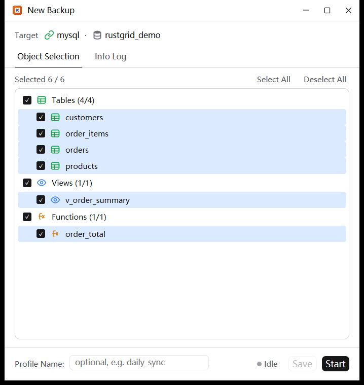

# Backup

RustGrid's own backup format is `.rgbak`: a single file with the schema and the rows, stored as compressed chunks with a JSON manifest.

## Create a backup

1. Select a database and open the **Backups** main tab.
2. Click **New Backup**. The window targets that connection and database.
3. On **Object Selection**, tick the tables and views to include. **Select All** / **Deselect All** speed up large schemas.
4. Give the configuration a name if you want to reuse the same selection, then click **Start**.

The **Info Log** tab shows object and record counts, live messages, elapsed time and the final success/failure totals. The progress bar turns green when the run completes.

## Restore and extract

- **Restore Backup** writes the selected backup back to the chosen database.
- **Extract SQL** turns a backup into a readable script, useful for review or for moving data through another tool.
- A saved configuration keeps the target and object selection; reopen it from the backup list to run the same job again.

## The backup list

- Each backup is listed with its name, modification date, file size and note. Click a header to sort.
- `F2` renames a backup, the toolbar deletes it after confirmation, and copying/pasting moves a backup file.
- Backups are kept per database in the RustGrid configuration directory.

## Notes

- Backup and restore cover MySQL/MariaDB, PostgreSQL, SQL Server, Oracle and SQLite. ClickHouse, Redis and MongoDB do not offer `.rgbak` backup in this version.
- Take a backup before **Sync**, a large import, or a destructive table change. The file contains both structure and data, so it restores on another machine and across versions of the same engine.
