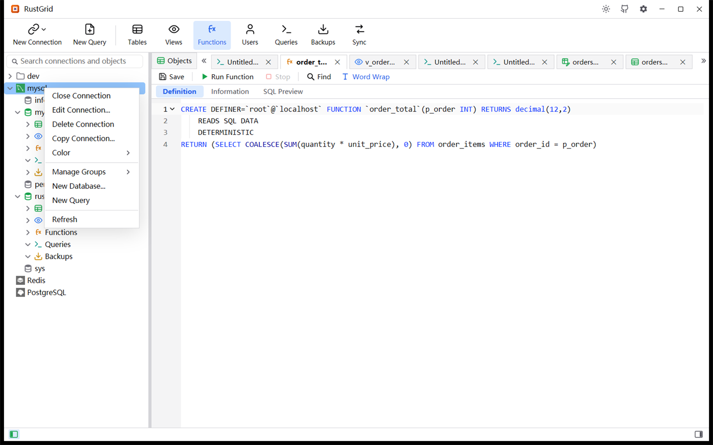
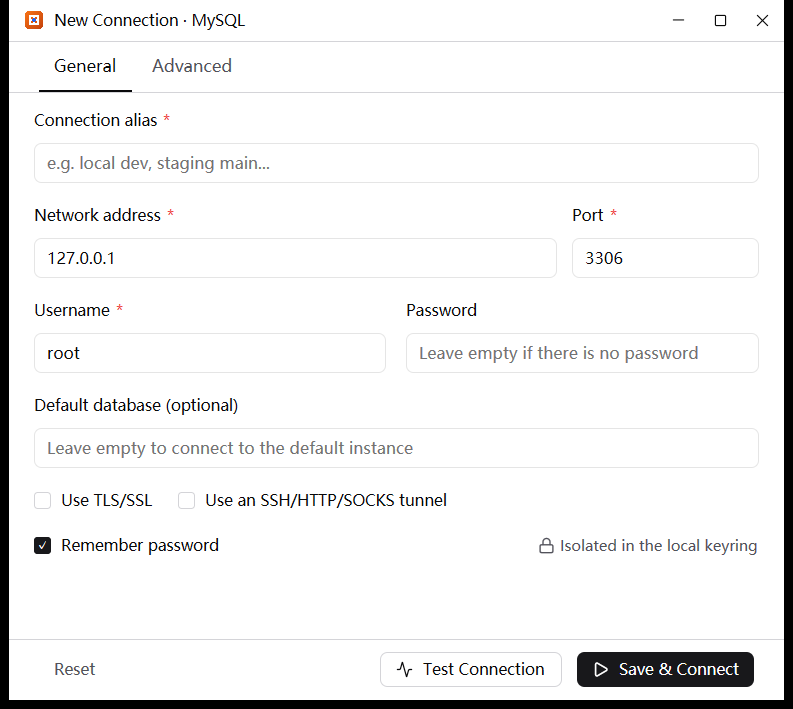
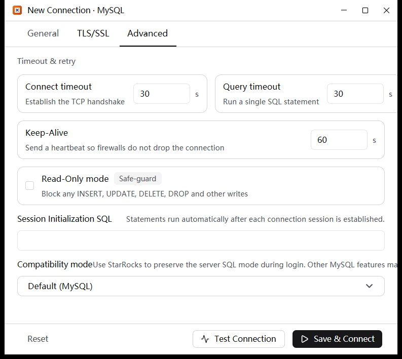

# Connections

The connection tree on the left is where everything starts. Connect, group and colour servers, then open databases and their objects.

## Create a connection

1. Click **New Connection** and choose an engine. The menu also ends with **Import Connections** and **Export Connections**.
2. Fill in the connection form. The name, host and port are required; the database is optional.
3. **Test Connection** is a safe check before saving, especially through a tunnel. **Save & Connect** stores the profile and opens it immediately.

- **Remember password** stores the password in the encrypted secret store. Without it, RustGrid prompts each time the connection opens, and never writes the password into `connections.json`.
- Engine-specific fields sit on the General page: Oracle's service name / SID / TNS alias, SQL Server authentication and application name, SQLite's file path and SQLCipher mode, Redis's key limit, and the ODBC driver or connection string.
- The username starts with the engine's own default (`root`, `postgres`, `sa`) or stays empty where there is no conventional account.

## TLS and tunnels

Both are **switches** on the General page; their pages only appear when switched on.

- **Use TLS/SSL** opens the TLS page: TLS mode (prefer / require / verify), CA file, client certificate, client key and MySQL's cleartext-password option. The page exists on MySQL, MariaDB, PostgreSQL, SQL Server, Oracle, ClickHouse and MongoDB.
- **Use an SSH/HTTP/SOCKS tunnel** opens the tunnel page. The driver connects to a local forwarded port, so the server host is resolved from the tunnel's point of view. Passwords and keys are part of the connection profile and are never shown in the tree.

## Advanced settings

The **Advanced** page holds the standard knobs every network engine honours:

- Connect timeout and query timeout, in seconds.
- Keep-alive, so a firewall does not silently drop an idle session.
- **Read-only mode**, which blocks INSERT, UPDATE, DELETE and DROP for that profile.
- **Session initialization SQL**, run after every new session is established.
- The compatibility mode where a driver offers one (MySQL's StarRocks mode, for example).

## Organise the tree

- **Groups**: right-click the blank tree area and choose **New Group**. Drag connections into a group, or use **Manage Groups → Move to**. Groups nest; **Exclude from Group** takes a connection back to the root. A group's **Delete** keeps its children by moving them up one level.
- **Colours**: a connection's context menu offers **Colour → Red / Yellow / Green**. The colour paints the whole subtree and every tab that belongs to that connection, so a production server stays visible. Picking the active colour again clears it.
- **Search**: the box at the top filters groups, connections, databases, schemas and tables. Qualified names work: `orders` matches a table, `sales.orders` matches schema + table, and `db.sales.orders` matches the fully-qualified name. **Down** / **Up** moves from the box into the results.
- **Refresh** reloads the database list and the objects behind each open database. A table created outside RustGrid appears without reconnecting.

## Import and export

- **Import Connections** accepts a RustGrid `.rgc` bundle, a Navicat `.ncx` file or DBX JSON. A `.rgc` also restores groups and their order; other formats import flat. Passwords are written to the encrypted store.
- **Export Connections** opens a small window: tick connections, choose whether to include passwords, then save one `.rgc`. Exported passwords are encrypted, never plaintext.

## Disconnect and delete

- **Disconnect** closes the server and every account or privilege window opened against it. The profile stays in the tree.
- **Delete Connection** removes the profile after confirmation. Stored passwords are removed with it.
- **Copy Connection** creates a duplicate profile, useful for a staging copy of the same server.
