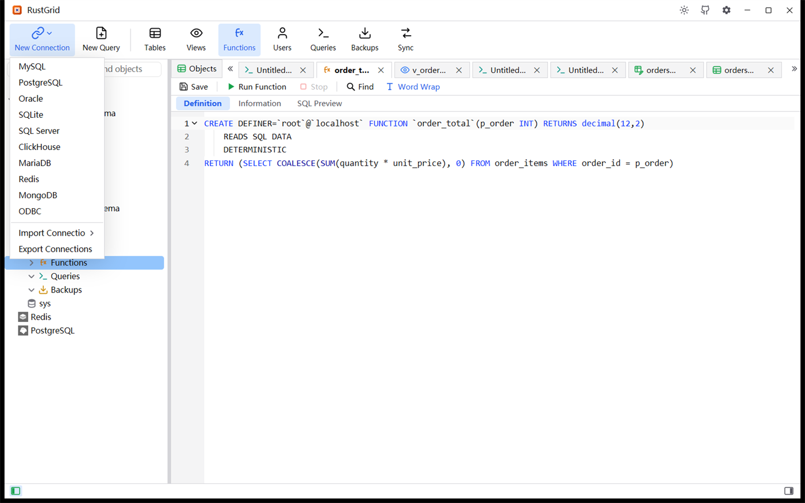

# Supported engines

RustGrid ships native drivers plus one generic ODBC driver, all behind the same UI. Each driver declares what it can do, so actions an engine cannot perform are hidden instead of failing at the end.

## Engines and capabilities

| Connection | What you get |
| --- | --- |
| **MySQL / MariaDB** | Tables, views, stored functions and procedures, accounts and privileges, table designer and `.rgbak` backup. |
| **PostgreSQL** | Schemas, tables, views, functions / procedures, roles and ACLs, table designer and backup. Object names are schema-qualified. |
| **SQL Server** | Schemas, tables, views, procedures / functions, logins and roles, table designer and backup. Windows authentication is available in Windows builds. |
| **Oracle** | Schemas, tables, views, functions / procedures / packages / triggers, users and roles, designer and backup. Connect with a service name, SID or TNS alias. |
| **SQLite** | A single database file, including SQLCipher 4 and SQLCipher 3 encryption. No server accounts, routines or events. |
| **ClickHouse** | Databases, tables and views over the HTTP interface. The grid is read-only; the designer edits fields, defaults and comments. |
| **Redis** | Numbered databases, key namespaces, strings, hashes, lists, sets, sorted sets and streams. Every key opens its own page with TTL and memory. |
| **MongoDB** | Databases, collections and documents. One document is one grid row, `_id` is the key, and the row form has a JSON view. |
| **ODBC** | Any installed ODBC driver; the table designer is disabled because a generic driver cannot reproduce indexes and options faithfully. |

The generic ODBC driver is a fallback for engines without a native Rust driver — DB2, Dameng (达梦) and others. It reads the engine from the connection's `odbc.engine` setting and then uses that engine's quoting, paging and literal rules.

## How the tree differs

- **Schema engines** — SQL Server, PostgreSQL and Oracle show database → schema → tables / views / functions / queries / backups.
- **Schema-less engines** — MySQL, MariaDB and SQLite go straight from database to objects.
- **Redis** replaces SQL categories with namespace folders, and a database row itself is the all-keys view.
- **MongoDB** names objects **collections** and replaces the SQL designer with a collection dialog.

## Capability-driven UI

The Users, Functions, Backup and designer tabs only appear when the connected driver supports them. The same rule hides edit actions on a read-only grid:

- ClickHouse has no unique row key, so update / delete are refused and the edit actions are hidden. Import still works.
- A query result that maps to one table is editable; one that joins several tables is read-only and opens a cell viewer on double-click.
- Redis key pages have their own editors instead of the SQL grid; streams and ReJSON keys are read-only.

## Connection fields

Each driver declares its own connection form. The General page carries the standard host / port / user / password fields, and the engine adds what it needs: Oracle's service name, SID or TNS alias; SQL Server authentication and application name; SQLite's file path and encryption mode; Redis's key limit; MongoDB's auth database; ClickHouse's HTTP / HTTPS port.

See [Connections](./connections.html) for the form, TLS and tunnel pages, and [Table designer](./table-designer.html) for the per-engine designer tabs.
