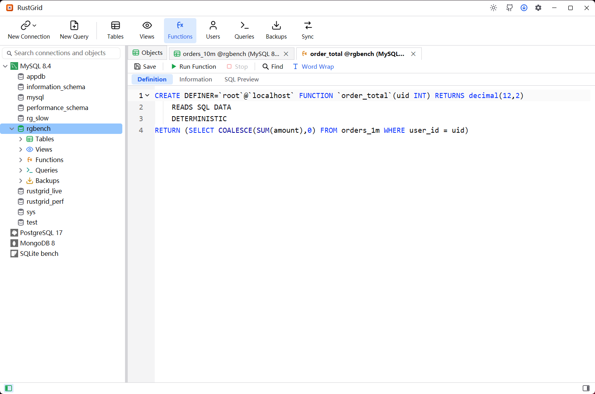

# Functions

Functions and stored procedures are listed per database and edited in the same SQL editor used by queries.

## The list

- The list shows the routine name, modification time, kind (function or procedure), whether it is deterministic, and its comment. Use the search box or switch between the tile and detailed layouts.
- **Design Function** opens the selected routine; **New Function** starts from a template; **Delete Function** asks for confirmation; **Run Function** executes it.
- The connection tree has a **Functions** category with the same actions, so a routine can be opened without the main tab.

## The routine editor

- **Definition** is the full `CREATE` statement loaded from the engine. It is editable with syntax highlighting, find and word wrap.
- **Information** shows the routine's kind, return type, definer, data access, determinism, SQL mode, character set and collation.
- **SQL Preview** is the script **Save** will run.
- **Save** drops the original routine and replays the edited `CREATE`, which is how a function's body, parameters and attributes are changed. `Ctrl+S` saves.
- **Run Function** wraps a function in `SELECT` and a procedure in `CALL`, then opens the call in a new query tab. A routine without arguments runs immediately; one with arguments leaves the call ready to fill in.

## Notes

- The tab title keeps the routine's database and connection, so several routines can stay open side by side.
- Routines are available on MySQL/MariaDB, PostgreSQL, SQL Server and Oracle. SQLite, ClickHouse, Redis and MongoDB do not have stored routines, so the category is hidden for them.
