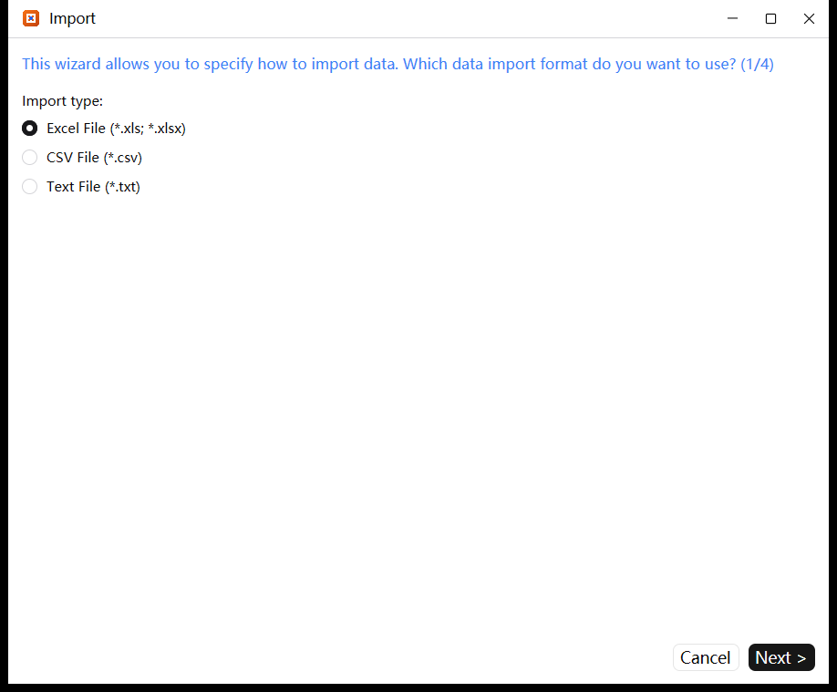
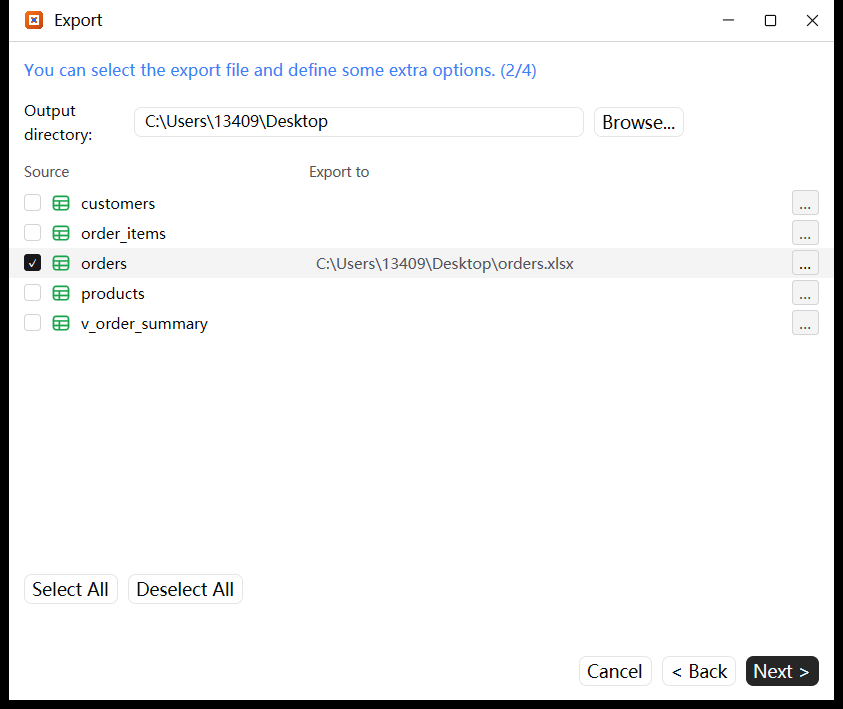

# Import & export

Two wizards move data in and out without writing SQL by hand. Both are separate windows, so the native file picker never blocks the main workspace.

## Import

**Import** in the table toolbar (or the table context menu) opens the four-page wizard:

1. **Import type** — Excel (`.xlsx`, `.xls`, `.xlsm`, `.xlsb`, `.ods`), CSV or text.
2. **Source** — choose the file. Each worksheet, or the single CSV/TXT table, becomes a row with an editable destination table name and a **Create Table** check box.
3. **Mapping** — each source column gets a destination field, matched automatically by a normalised header name. Unmatched columns are simply not imported.
4. **Run** — rows are inserted in batches; the log reports progress and per-row errors.

- A source table whose name matches an existing table targets it. Otherwise the name becomes a new table and **Create Table** is ticked automatically.
- A created table's columns and types are inferred from the data: integer → `bigint`, decimal → `decimal(20,6)`, dates → `date` / `datetime`, booleans → `tinyint(1)`, text → `varchar` / `longtext`. The `id` column becomes the primary key.
- Date/time values are parsed day-first, so `26/6/2025` is 26 June, and rewritten to the engine's canonical form.
- A malformed row is reported in the log; **Stop on error** decides whether the run continues.

## Export

**Export** opens the four-page wizard for `.xlsx`, `.csv`, `.sql` or `.txt`:

1. **Format** — choose the output type.
2. **Tables and paths** — tick the tables to write and set each output path. The native folder / file dialog starts on the desktop.
3. **Columns** — choose the exported fields per source table. All fields are selected by default.
4. **Options and run** — include column titles, continue on error, then **Start**. The log shows total / processed rows, elapsed time and the final result.

- A grid's own **Export** first asks **All records** or **current N records**. The current-page export uses exactly the rows on screen, with the applied filter and sort, and does not re-read the table.
- A table export reads the rows in pages ordered by the primary key, so offsets stay stable; a table without a key exports in the engine's natural order.
- Query results can export several result sets. Selecting more than one writes them into one `.xlsx` workbook, one worksheet per result; other formats write one file per result.
- **SQL** output contains `INSERT` statements that can be replayed on the same engine. Use a [backup](./backup.html) when you need schema and data together.

::: tip Large files
Export streams rows, but `.xlsx` is buffered until the workbook is written. For a very large table, CSV or SQL output uses less memory and can be split by exporting selected pages.
:::
