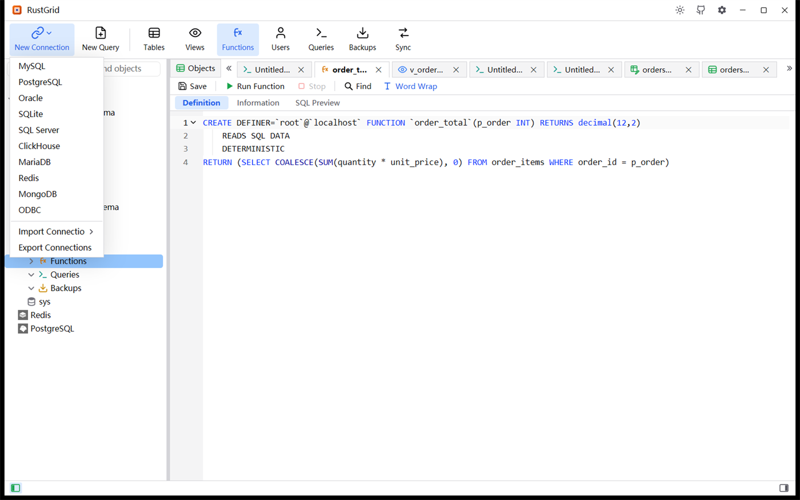

# Install & first launch

RustGrid is a single native executable: there is no installer and no runtime to add. Download the archive for your platform from [Releases](https://github.com/yisier/rustgrid/releases/latest), unpack it and start `RustGrid`.

## Choose your build

| Platform | Package | Notes |
| --- | --- | --- |
| Windows 10/11 | `.zip` (x64 or arm64) | One `RustGrid.exe`; the ODBC driver manager is loaded only when needed. |
| macOS 13+ | `.tar.gz` (contains `RustGrid.app`, Intel and Apple Silicon) | Unsigned build; the first launch uses the context menu → **Open**. |
| Linux x64 / arm64 | `.tar.gz` | One binary; no libraries beyond the desktop's normal GTK setup. |

The download is around 10 MB. Themes, connections, saved queries and backups live in the OS configuration directory, not beside the executable.

## Make the first connection

1. Click **New Connection** in the toolbar and pick an engine. MySQL is a good first choice.
2. Enter the host, port and user name. The database is optional; SQLite takes a file path instead, and ODBC takes a driver or a connection string.
3. Use **Test Connection** to check the settings, then **Save & Connect**. If the password is not remembered, RustGrid asks for it when the connection opens.

The password is stored only when **Remember password** is on, and it goes to the encrypted secret store, never to the connection profile. The full form is described on [Connections](./connections.html).

## First steps

- Open a database in the tree, select a table and double-click it. The table opens in its own tab as a paged grid.
- Press **New Query** to run SQL against the selected connection and database.
- Open **Backups** and take a `.rgbak` file before a large change.
- Use **Sync** to compare two databases and preview every difference before writing.

## Updates and removal

Open **Options → About** to see the current version, check GitHub for a newer release and read that release's changelog. The app downloads the asset that matches the current platform and installs it in place.

To remove RustGrid, delete the executable or the `.app` bundle. The configuration directory can be removed separately if you also want to delete connections, saved queries and backups.

::: tip Platform notes
The macOS build is unsigned, so a quarantined download needs **Open** from the context menu once. A quarantined copy cannot update itself until it is moved out of quarantine. Linux builds need no extra services, and Windows needs no ODBC installation unless you actually create an ODBC connection.
:::
