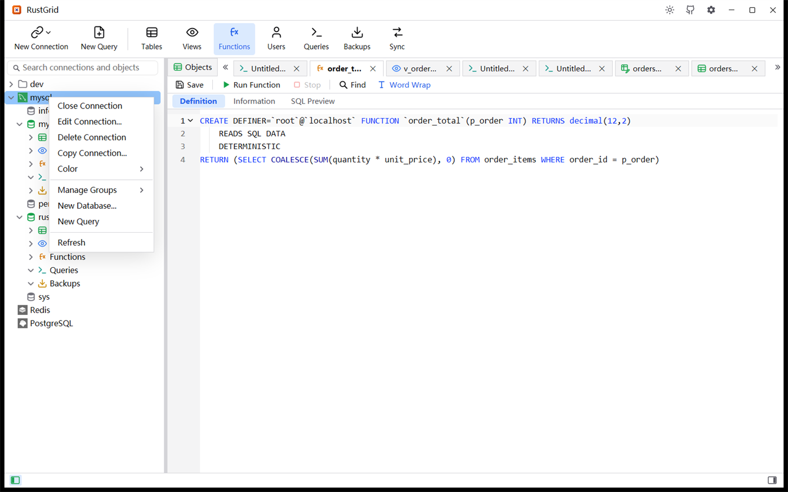

# Quick start

Download the archive for your platform from [Releases](https://github.com/yisier/rustgrid/releases/latest), unpack it and run `RustGrid`. There is no installer and no runtime to install; the Windows build is a single `RustGrid.exe`.

## Connect

1. Click **New Connection** and pick an engine.
2. Enter the host, port, user name and password. SQLite takes a file path; ODBC takes a driver or connection string.
3. **Test Connection**, then **Save & Connect**.

The password is only stored when **Remember password** is on, and it goes to the encrypted secret store rather than the connection profile. A missing password opens the prompt when the connection is used.

## First steps

- Open a database in the tree, pick a table and double-click it to page the rows.
- Press **New Query** to run SQL against the selected connection and database.
- Open **Backups** to take a `.rgbak` backup before making large changes.
- **Sync** compares two databases and previews the differences before writing.

## Engines

| Type | Engines |
| --- | --- |
| SQL | MySQL, MariaDB, PostgreSQL, SQL Server, Oracle, SQLite, ClickHouse |
| NoSQL | Redis, MongoDB |
| Generic | ODBC (DB2, 达梦, other ODBC drivers) |

Details and limitations are on the [Supported engines](./engines.html) page.

## Platforms

Windows 10+, macOS 13+ (Intel and Apple Silicon) and Linux x64 / arm64.

- **macOS**: the build is unsigned, so the first launch needs the context menu → **Open**. The app can update itself; a quarantined copy asks to be moved out of quarantine first.
- **Linux**: the archive contains the binary; no system libraries beyond the desktop's normal GTK setup.
- **Updates**: **Settings → About** checks the latest release and shows its changelog. The app downloads the matching asset for the current platform.

To uninstall, delete the executable or the `.app` bundle. Settings, connections and backups live in the OS configuration directory and can be removed separately.
