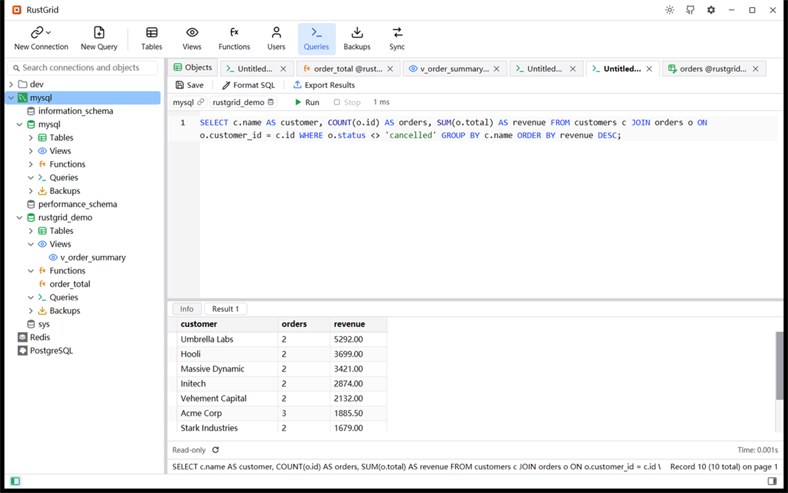

# Queries

The query editor is a full SQL workspace: write, format, run and keep results as editable grids.

## Start a query

- **New Query** (or **Ctrl+Q**) opens an editor tab. It uses the connection and database selected in the tree; both can be changed from the tab's own toolbar.
- The connection + database pair belongs to that tab, so different tabs can target different servers.
- A **group query** opened from a connection group runs the same SQL against every member and gives each connection its own result page.

## Write and run

- Syntax highlighting, keyword / table completion (**Ctrl+Space**), **Format SQL**, **Explain**, find (**Ctrl+F**), line numbers and word wrap.
- **Ctrl + mouse wheel** zooms the editor. The font, line-number and wrap settings from **Options → Editor** apply to editors that are already open.
- **Ctrl+R** runs the script; **Ctrl+Shift+R** or **Ctrl+Enter** runs the selection. The statement limit and stop-on-error behavior are in **Options → General**.
- A multi-statement script runs on one pinned session, so `SET`, transactions and `USE` survive between statements where the driver supports it.

## Results

- Every statement that returns rows gets a **Result N** tag beside **Info**; click a tag to switch grids. The result strip scrolls and shows ◀ / ▶ when the tags do not fit.
- The result grid has the same controls as a table grid: sort, filter, field layout, copy and export. Results that map to one table can be edited in place; others open a read-only cell viewer on double-click.
- Query grids page on the client: the whole result is held by the tab, and paging does not re-run the statement.
- **Export Results** writes one result set, or several selected results into one `.xlsx` workbook (one sheet per result). Other formats keep one file per result.

## Save and reuse

- **Ctrl+S** saves the query. An already-saved tab overwrites its file without a prompt; a new tab asks for a name and a connection / database location.
- **Queries** lists saved queries with name, connection and database columns. The list follows the tree selection: a database shows its queries, a connection shows all of its databases, and any other selection shows everything. Click a header to sort, double-click to open, **F2** to rename and the toolbar to delete.
- Saved queries live under the configuration directory's `queries/` folder and are restored with the same connection when possible.

## Group queries

- Select a group in the tree and choose **New Query** (or use the group's context menu). The editor's **Info** / connection tags show one page per server.
- A closed member is connected for the run but its tree row is not expanded. A missing password, connection error or SQL error is reported on that server's page, so one failure does not block the others.
- No database is selected for a group query: each connection runs in its own default context, so database-independent statements work and `USE` or fully-qualified names address a database per server.
- A saved group query lives under `queries/_groups/<group-id>/` and reopens as a group tab when its group or one of its members is selected.

::: tip Before a large run
Use **Explain** to check the plan, and wrap destructive statements in a transaction where the engine supports transactional DDL. A query tab has no undo history for data changes.
:::
