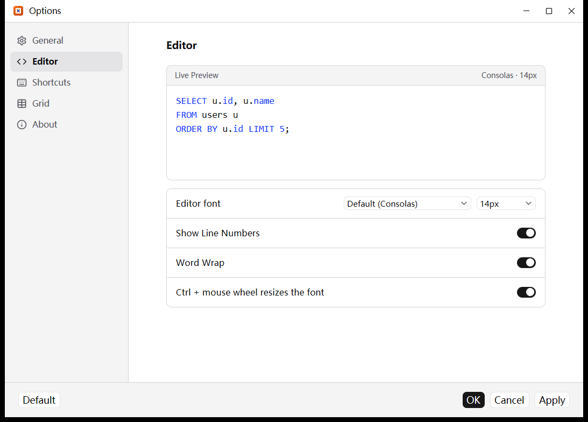
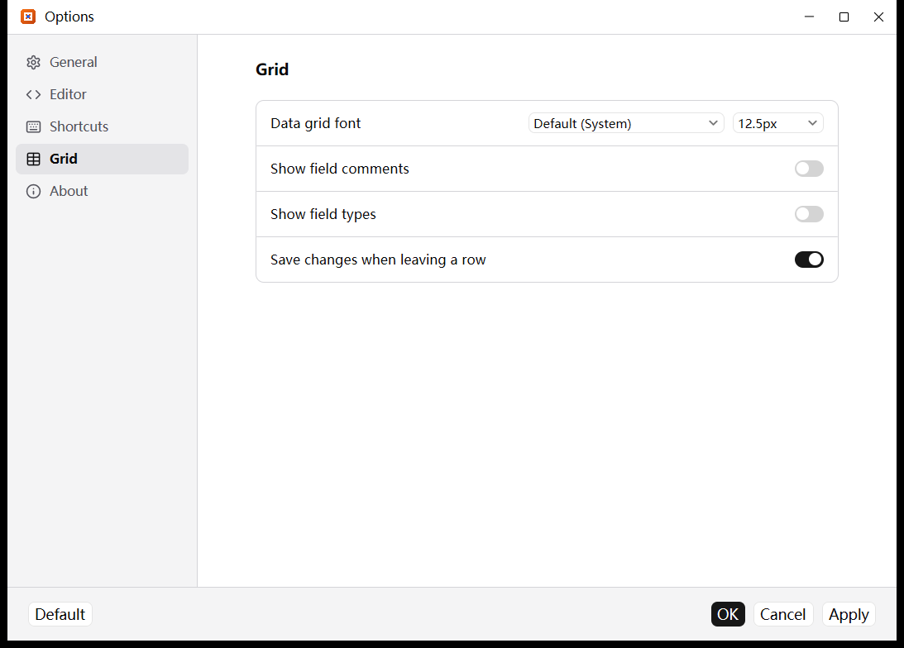
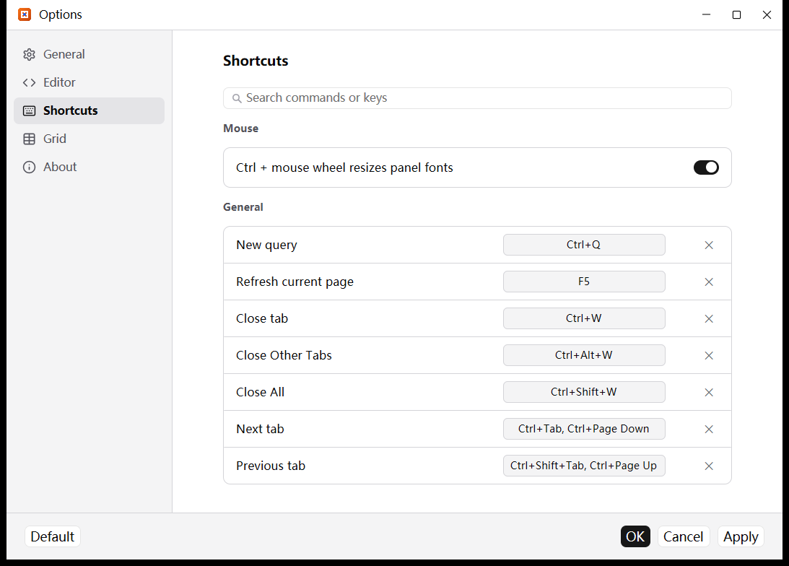

# Settings

Open **Options** from the gear in the title bar. The window keeps its changes as a draft until **Apply** or **OK**; **Cancel** discards them and **Default** restores the built-in values.

The window itself is deliberately terse: each row shows only the option's name and its control. The notes below explain what each option does.

## General

Configures the interface language, typography and query execution behaviour.

### Appearance & Fonts

- **Interface language** changes the display language of menus and messages immediately. English, Simplified Chinese and Russian are available.
- **Navigation panel** sets the font family and size of the connection tree and the object lists.
- **Main panel** sets the default font for tab bars, status bars and dialogs.

### Workspace

- **Restore on startup** restores query tabs, connections, open databases and table tabs at the next start. Turn it off for a clean start where the tree begins collapsed.
- **Single-click mode** opens connections, databases, tables and other objects with a single click. Off (the default) uses double-click, like Navicat.
- **Keep the object search** keeps each list's own search (tables, views, functions, queries) when switching tabs, databases or connections. Clicking a main tab still clears that tab's search.

### SQL Execution

- **Statement limit per run** runs at most this many statements at a time and skips the rest with a notice. `0` means no limit.
- **Stop running a script when a statement fails** stops a multi-statement script at the first failed statement.

## Editor

Customizes the SQL editor's typography and interactions. Changes apply to editors that are already open, not only to new ones.

- **Editor font** and **Font size** choose the typeface used by the query editor. A monospaced family keeps fields and indentation aligned.
- **Show line numbers** shows a line-number gutter beside the editor.
- **Word wrap** wraps long lines at the editor's visible width.
- **Ctrl + mouse wheel resizes the font** lets you hold Ctrl and scroll over a query editor to zoom. A normal wheel still scrolls the editor.

## Grid

Controls how the data grid and the table designer present columns.

- **Data grid font** sets the cell font in query results and table data.
- **Show field comments** shows each column's comment under its name in the grid header.
- **Show field types** shows each column's data type (for example `VARCHAR`, `INT`) in the header.
- Both header lines are off by default because every extra line makes the header taller.
- **Save changes when leaving a row** saves a row when you leave it (**Up** / **Down** or a click on another row); **Enter** and **Tab** only stage cells. A change that spans several cells, a paste or a fill waits for **Save**. Turn this off to collect edits and press **Ctrl+S** yourself.

## Shortcuts

Search commands by name or key, click a command's field and press the new combination (**Esc** cancels). `↺` restores the command's default binding and `✕` removes it.

- **Ctrl + mouse wheel resizes panel fonts** — hold Ctrl and scroll over the navigation panel, main panel or table grid to zoom that font.
- Conflicts are marked in the list, so two commands cannot silently share a keystroke.

## About

Shows the current version, checks GitHub for a newer release and displays that release's changelog.

Settings and shortcut bindings are stored in `settings.json`; passwords are never written there. The site follows the browser language on a first visit — English by default, Chinese for a Chinese browser — and remembers a manual choice from the language menu.
