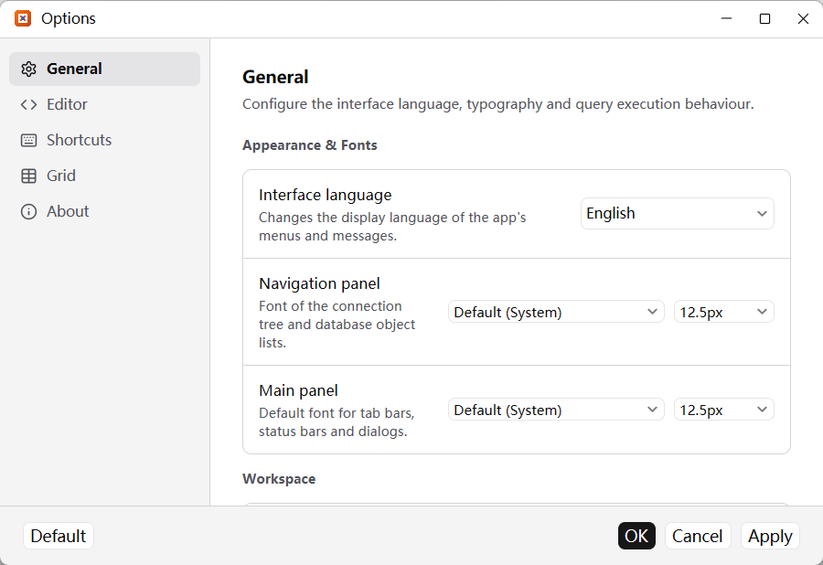

# Settings

Open **Options** from the gear icon in the title bar. The window keeps its changes as a draft until **Apply** or **OK**; **Cancel** discards them and **Default** restores the built-in values.

## General

- **Interface language** switches the menus and messages immediately.
- **Navigation panel** and **Main panel** set the font family and size of the tree, tabs, status bars and dialogs.
- **Restore on startup** reopens the previous query tabs, connections, databases and table tabs.
- **Single-click mode** opens connections and objects with one click; leave it off for double-click, like Navicat.
- **Keep the object search** preserves each list's search text when switching tabs, databases or connections.
- **Statement limit per run** caps a multi-statement script (0 means no limit), and **Stop on error** stops it at the first failed statement.

## Editor

- Font family and size, with a live preview.
- **Show line numbers** and **Word wrap** take effect in every open query editor, not only new ones.
- **Ctrl + mouse wheel** zooms the editor while reading; the setting itself does not change.

## Grid

- **Data grid font** controls cells in table pages and query results.
- **Show field comments** and **Show field types** add a small second or third line under the column name. Both are off by default because they use header height.
- **Save changes when leaving a row** applies the Navicat record model: `Enter` and `Tab` only stage cells, and the row is written when you leave it with `Up` / `Down` or a click. Turn it off if you prefer to collect edits and press `Ctrl+S` yourself.

## Shortcuts

Search commands by name, click a command to record a new key combination, and use the reset action to restore its defaults. The search box filters across every group.

## About

Shows the current version, checks GitHub for a newer release and displays that release's changelog. The site's own news is separate from the app version.

Settings and shortcut bindings are stored in `settings.json`; passwords are never written there. **This site** follows the browser language on a first visit — English by default, Chinese for a Chinese browser — and remembers a manual choice from the language menu.
