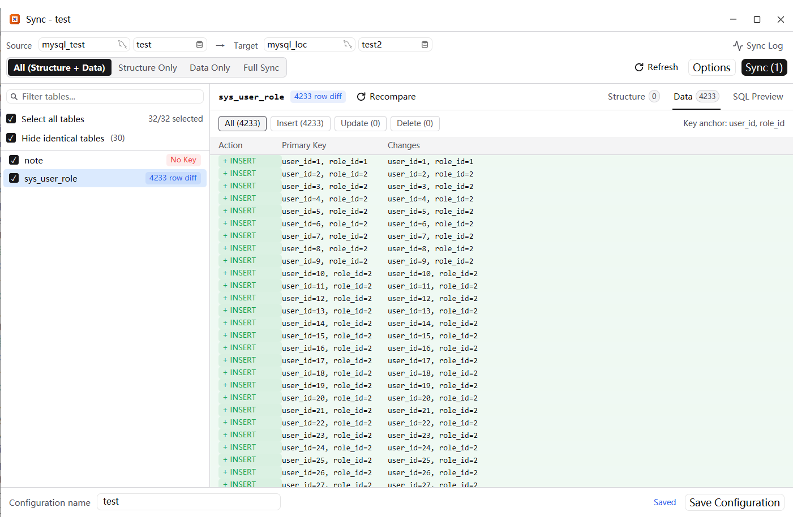

# Sync

Compare two databases and write only the differences.

- Pick the source and target connection and database.
- Compare **Structure + Data**, **Structure Only**, **Data Only**, or **Full Sync**.
- Each table lists inserts, updates and deletes, with a SQL preview and a row-level diff.
- Filter tables, hide identical tables, save the configuration and sync in one click.
