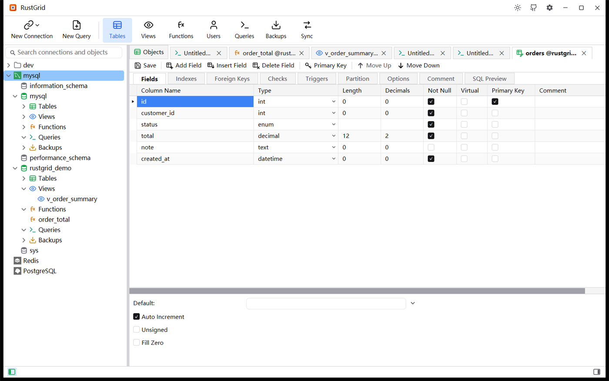
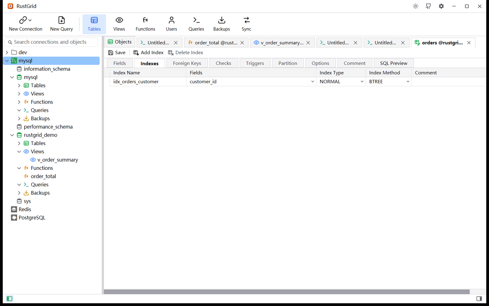

# Table designer

The designer edits a table's structure and shows the exact SQL before anything reaches the server. It is opened with **Design Table** from the object list, the table context menu or the connection tree.

## The layout

- The top tabs are the parts of the table: **Fields**, **Indexes**, **Foreign Keys**, **Checks**, **Triggers**, **Partition**, **Options**, **Comment** and **SQL Preview**. An engine only shows the tabs it can honour.
- The field grid is the main editor: name, type, length, decimals, `NOT NULL`, virtual, primary key and comment.
- The detail panel under the grid edits the selected field's default, auto-increment, unsigned and zero-fill flags. MySQL/MariaDB add the enum member editor and collation.
- The toolbar offers **Save**, **Undo**, **Add**, **Insert**, **Delete**, **Copy**, **Primary Key**, **Move Up** and **Move Down**. A new field is appended below the selection.

## Fields

1. Press **Insert** or **Add** to append a field and start typing its name.
2. Choose a type from the drop-down, or type a type such as `varchar(80)` / `int unsigned` when it is not listed.
3. Fill in length / decimals, then tick `NOT NULL`, primary key or the engine's options.
4. **Save** compiles the differences into `ALTER TABLE` statements. An unchanged design reports **No changes to apply**.

The search box in the **Name** header finds a field by name (**Ctrl+F** puts the caret in it). Typing over a selected range writes the same value into every selected cell of that column, and pasting text fills the selection the same way. **Copy** appends a copy of the selected fields (they get unique names and no key/auto-increment flags). Edited and newly added fields are highlighted until you save; the designer never saves on its own — only **Save** / **Ctrl+S** writes to the server. **Undo** (or **Esc** over the grid) reverts the last change, and **Ctrl+Z** does the same.

An empty or duplicated field name is underlined and stops Save with a message. A pure reorder is detected too, so moving fields produces `MODIFY COLUMN ... FIRST / AFTER` instead of being ignored.

## Indexes, keys and checks

- The **Indexes** grid lists the table's secondary indexes. The primary key has no row here: its name and kind are the key's own, and its columns are the primary-key flags on the Fields tab.
- **Add Index** adds a row; the **Fields** cell opens a small editor where each column carries its own options (`Sort` everywhere, `PrefixLength` on MySQL/MariaDB). **OK** keeps the draft, **Cancel** discards it.
- **Foreign Keys** maps a local column list to a referenced table and its columns, with update / delete actions.
- **Unique Keys** and **Checks** are only shown on engines that support them. SQL Server adds both.

## SQL preview and saving

- **SQL Preview** shows the exact script Save would run. It stays empty until there is a change.
- **Ctrl+S** saves from anywhere in the designer. The root keeps a key context of its own, so the shortcut works even while the field grid has focus.
- On SQL Server, `ALTER COLUMN` cannot add an identity. The auto-increment control is therefore limited to a new field or a new table.

## Keyboard

- **Tab** / **Shift+Tab** walks the field cells: name → type → every engine cell → next row.
- Arrow keys, **Home** / **End**, **Page Up** / **Page Down** move the selected cell. **Enter** or **F2** opens the editor; typing a character starts editing with it.
- **Ctrl+F** opens the field search, **Insert** adds a field, **Ctrl+Delete** deletes the selected fields, and **Ctrl+Up** / **Ctrl+Down** moves them.
- **F6** switches between the grid and the detail panel.

## Safety

Saving runs one or more `ALTER TABLE` statements. There is no automatic backup, so take a [backup](./backup.html) before changing a large or production table. Read the SQL preview when a change drops a column, changes its type or rebuilds an index.
