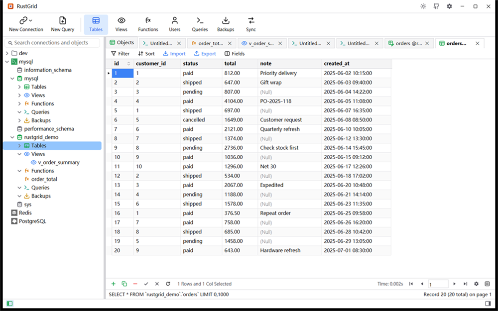
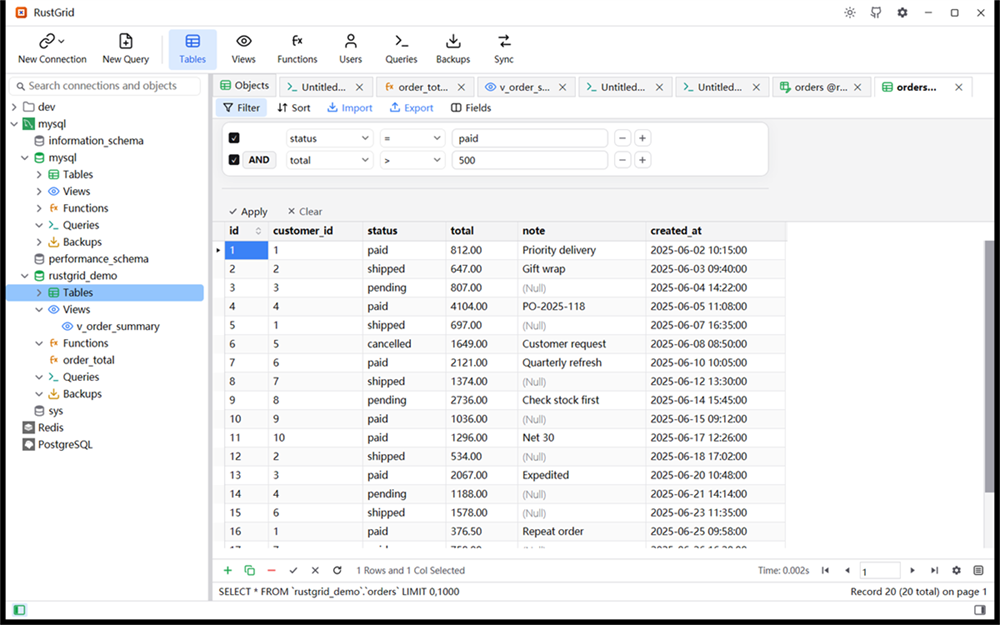
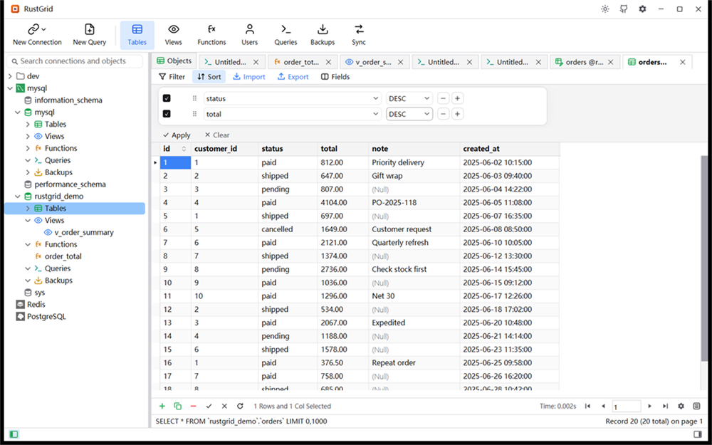
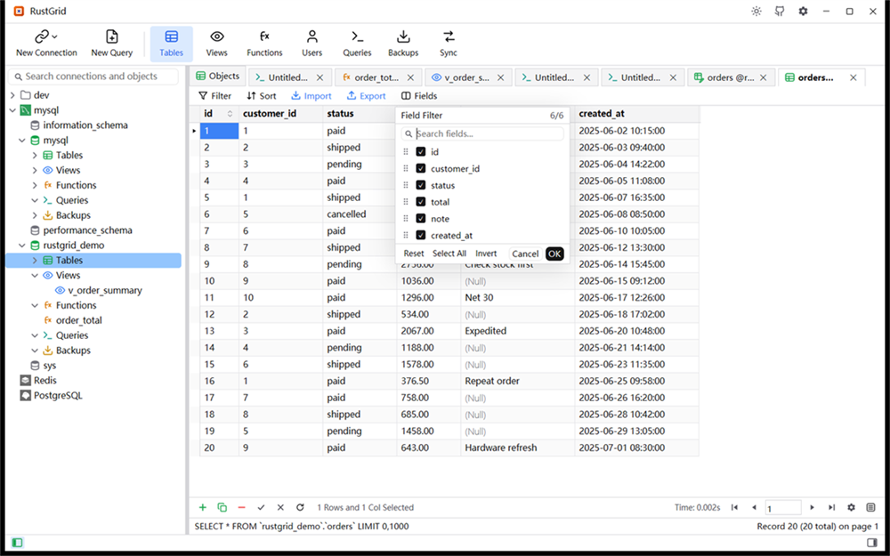
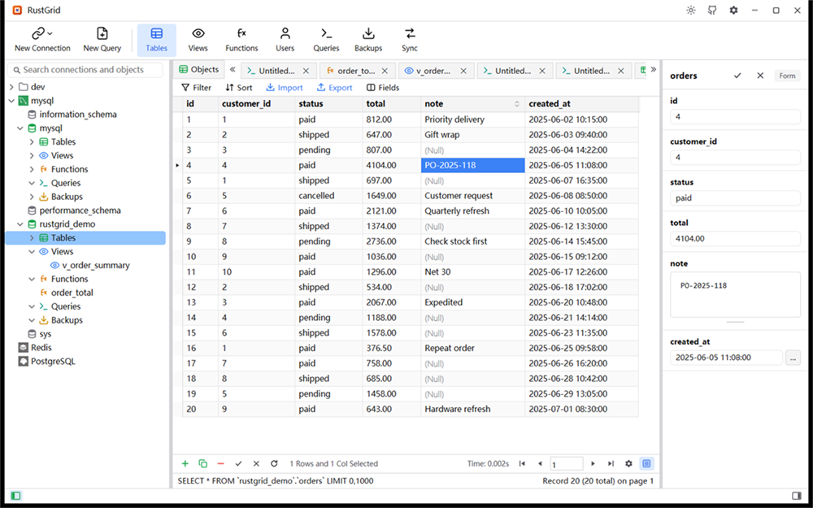

# Tables & data grid

A table opens as a paged data grid with in-place editing. It is the main place to inspect and change rows, and the same grid is reused for query results and views.

## Open and page

- Double-click a table in the object list (or press **Enter**) to open it in a tab. Each tab keeps its own page, filter and sort.
- The default page is 1,000 rows. The **Limit records** panel offers 100 to 10,000 rows or no limit; the pager shows the total row count and jumps to a typed page.
- Paging is stable because the grid orders by the primary key. A table without a primary key falls back to the engine's natural order.

## Read

- The header shows the field name. **Options → Grid** can add the field's data type and comment underneath.
- JSON, long text and binary values get a short preview; the **row form** shows the whole value, with a JSON format switch and a date/time picker.
- The **Form** button at the right end of the footer opens the selected row as a vertical form. It is the easiest way to edit a wide table or a long text value.

## Edit

- Double-click a cell, or press **Enter** / **F2**, to edit. **Enter** and **Tab** move between cells; the edit is staged, not written yet.
- Leaving the row with **Up** / **Down** or a click on another row saves it when **Options → Grid → Save changes when leaving a row** is on. **Ctrl+S** saves the staged changes immediately.
- The toolbar's `+` appends a record; **Duplicate row** copies the selected record beneath it; the delete action removes selected rows. A new record shows column defaults, `(Auto)` or `(Generated)` values.
- Unsaved changes are counted beside the save / discard buttons. **Esc** or **Discard** asks for confirmation before dropping them.
- A table with no primary key is edited with every column as the row identity. This still works, but a duplicate row is ambiguous.

## Filter

**Filter** opens a tree builder: conditions can be grouped with **AND** / **OR**, and each node (including a whole group) has an enable check box.

- Choose a field, an operator (`=`, `<>`, `<`, `>`, `LIKE`-style contains / starts / ends) and a value.
- `+` adds a condition or a group; `−` removes the row; the pill between groups flips AND / OR.
- **Apply** sends the tree to the engine, so paging and counts reflect the filtered result. **Clear** removes every condition.
- A disabled node is skipped without being deleted, which is handy for keeping a filter for later.

## Sort

**Sort** holds an ordered list of fields. Drag a rule by its grip to change precedence, and use the direction control to switch between ascending and descending.

- **Apply** runs the request; **Clear** removes it.
- Sorting is also sent to the engine, so the first page is the first page of the sorted result, not a client-side reorder.

## Field layout

**Fields** opens the field filter popup: search, toggle visibility and drag fields into a new order.

- The edit is a draft until **OK**; **Cancel** or a click outside discards it.
- The layout is remembered per connection, database and table. A field added to the table later is appended rather than lost.
- Right-click a column header for **Freeze column**, **Unfreeze**, **Unfreeze all**, **Hide column** and **Refresh**. Frozen fields stay at the left while the rest scrolls.

## The row form

The **Form** button opens the selected row in the right-hand pane. Each field becomes a labelled editor with its type and comment, so a wide table or a long JSON document is easier to read than in a horizontal grid.

- Typing stages the value in the grid's pending edit; **Enter** or **Ctrl+S** saves it.
- **Esc** restores the page's value for that field.
- A temporal field has the same `…` picker as the grid cell; a long text or JSON value gets a resizable multi-line editor with a format switch.

## Table actions

- **Design Table** opens the [table designer](./table-designer.html) with fields, indexes, foreign keys, unique keys, checks and options; its **SQL Preview** shows the script before saving.
- The object context menu also offers **Rename** (**F2**), **Empty Table**, **Truncate Table** and **Drop Table**. Destructive actions go through the shared confirmation dialog.
- The detailed object list shows the engine's table overview: rows, data length, index length, engine, collation, auto-increment and modification date.
- **Import** and **Export** open the [wizards](./import-export.html) for Excel, CSV, TXT, SQL and `.xlsx`.
