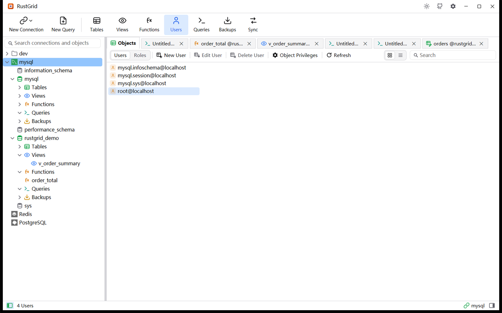
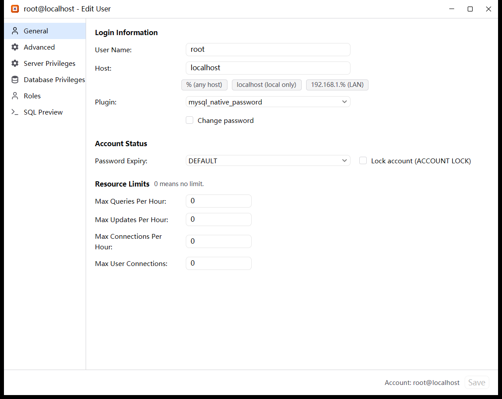

# Users & privileges

The **Users** main tab lists the server's accounts. It covers MySQL/MariaDB, PostgreSQL, SQL Server and Oracle; engines without server accounts hide the tab.

## The list

- The **Users** / **Roles** tabs switch between accounts and roles.
- The toolbar offers **New User**, **Edit User**, **Delete User**, **Object Privileges** and **Refresh**. A search box filters the list.
- **F2** renames an account in place where the engine allows it.
- Disconnecting the connection closes every account and privilege window opened against it, so nothing is left editing over a dead session.

## Create or edit an account

**New User** and **Edit User** are the same window. A left navigation shows five sections over one shared editor:

1. **General** — user name, host, authentication plugin, password change, account lock, password expiry and the hourly resource limits.
2. **Server Privileges** — the global `*.*` grid with one-click presets.
3. **Database Privileges** — a database list beside the selected database's detail: all tables or specific tables, quick presets and grouped fine-grained privileges.
4. **Roles** — the member-of and members lists; the **Admin** column grants `WITH ADMIN OPTION`.
5. **SQL Preview** — the script Save will run.

**Save** is one path for both flows. Changing the user name or host emits `RENAME USER` before the rest of the script, so the account keeps its grants and role edges. A successful save reloads the account in place.

## Object privileges

**Object Privileges** opens the object-level manager for the selected account. It lists the database objects the account can reach and grants / revokes per object. The same manager is available from the object list where a driver exposes object ACLs.

## Good practice

- Passwords are prompted on connect and are never stored in a connection profile.
- Avoid editing the account you are connected as without a second administrator session; a mistaken `REVOKE` can lock you out.
- Review **SQL Preview** before saving a role or privilege change. The preview is exactly what Save runs.
- For MySQL, a database that only has a `GRANT USAGE ... WITH GRANT OPTION` entry still appears in the list. Removing the grant option is a separate revoke from removing the database.
