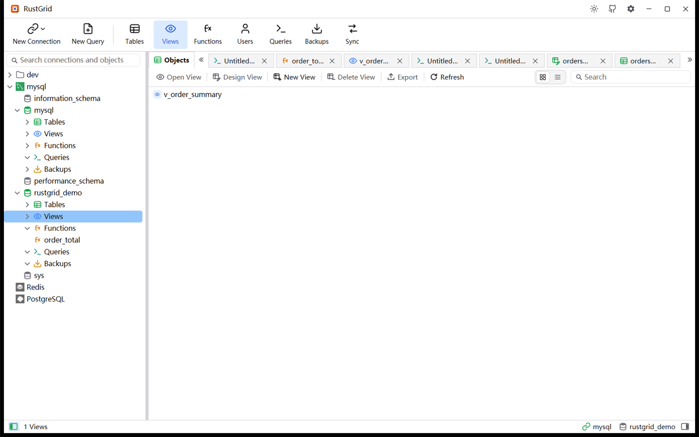
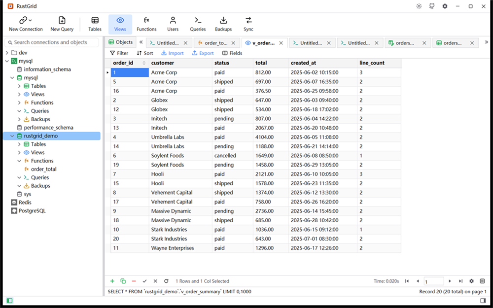

# Views

Views are listed per database and open in the same paged grid as tables. The **Views** main tab follows the tree selection, so a schema-aware engine shows the views of the selected schema.

## Browse and open

- Double-click a view to open its data. **Open View** does the same from the toolbar; **Enter** opens the selected row.
- The grid is read-only where the engine cannot guarantee a unique row, and editable where the view maps to one table and the driver reports a key.
- The connection tree has a **Views** category with the same actions, so a view can be opened without the main tab.

## Design a view

**Design View** opens the view designer as a main-content tab, reusing the SQL editor:

- **Definition** is the full editable `CREATE ... VIEW` statement loaded from the engine.
- **Advanced** holds the definer, security type, algorithm, check option, updatability, timestamps and charset / collation where the engine reports them.
- **SQL Preview** shows the script **Save** will run.
- The toolbar offers **Save**, **Preview**, **Explain** and **Format SQL**.

**Save** derives the view name from the statement, drops the original view and replays the edited `CREATE` through the connection. **Preview** opens the saved view's rows in a grid; **Explain** runs the definition's `SELECT` and shows the plan in the designer's bottom **Info / Explain** panel.

## Notes

- Views are available on MySQL/MariaDB, PostgreSQL, SQL Server, Oracle, SQLite and ClickHouse. Redis and MongoDB have no SQL views.
- Changes to a view's definition do not change its data; use **Refresh** in the object list after saving.
- A view that reads a dropped table fails on open. The error appears in the grid's status area rather than closing the tab.
