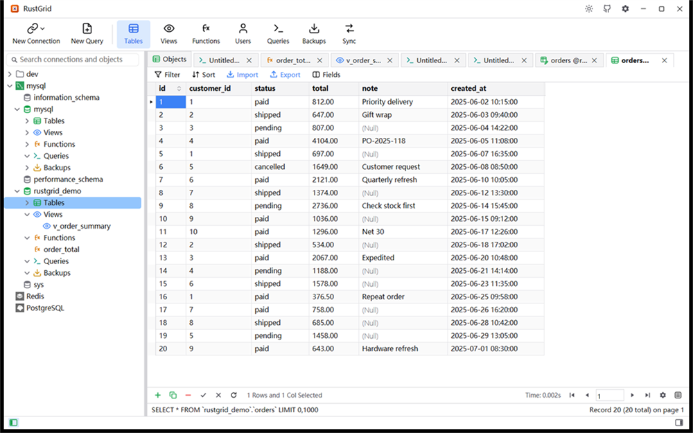

# The main window

RustGrid follows Navicat's layout: a connection tree on the left, a tabbed workspace on the right and one shared command toolbar above both. Once you know these four regions, every module works the same way.

## What is on screen

| Region | What it does |
| --- | --- |
| **Title bar** | Window controls, the theme switch, update status and **Options** (the gear). |
| **Command toolbar** | **New Connection**, **New Query**, and the main tabs: Tables, Views, Functions, Users, Queries, Backups, Sync. |
| **Connection tree** | Groups and connections, then databases, schemas and their objects. This is also where colours, groups and search live. |
| **Content tabs** | Every opened object, query, designer or list gets a tab. Tabs can be dragged, closed and scrolled. |
| **Status bar** | Connection, database, row counts and messages for the current page. |

## Open a database and its objects

1. Double-click a connection to connect. A stored password is used automatically; otherwise the password prompt appears.
2. Double-click a database to open it and show its tables. A single click on an open database switches the object list to it without collapsing it.
3. Select a table, view or function and double-click to open it. **Enter** opens the selected object, and **F2** renames it in place.
4. The main tabs decide which object category the list shows. A connection with schema support (SQL Server, PostgreSQL, Oracle) adds a schema level between database and objects.

A plain click on a connection only selects it. Double-click, **Enter** or **Connect** actually opens it; this prevents a production server from connecting by accident.

## Main tabs and content tabs

The main tabs are pages, not documents. Switching from **Tables** to **Views** replaces the object list; opening a table adds a content tab without losing the list.

- A content tab keeps its own page number, filter, sort and selection.
- Tabs can be reordered by dragging. The tab strip scrolls with the wheel or its ◀ / ▶ buttons when many tabs are open.
- **Close other tabs**, **Close all** and **Close tab** are in the tab's context menu and in Options → Shortcuts.
- The tab title carries the object, database and connection, so several similar tables remain distinguishable.

## Workspace options

- **Restore on startup** (Options → General) brings back query tabs, connections, open databases and table tabs at the next start. With it off the app starts clean and the tree is collapsed.
- **Single-click mode** opens connections, databases and objects with one click. The default is Navicat's double-click.
- **Keep the object search** keeps each list's search when you move between databases; clicking a main tab still clears that tab's search.

Continue with [Connections](./connections.html) to fill the tree, or jump to [Tables](./tables.html) to work with data.
