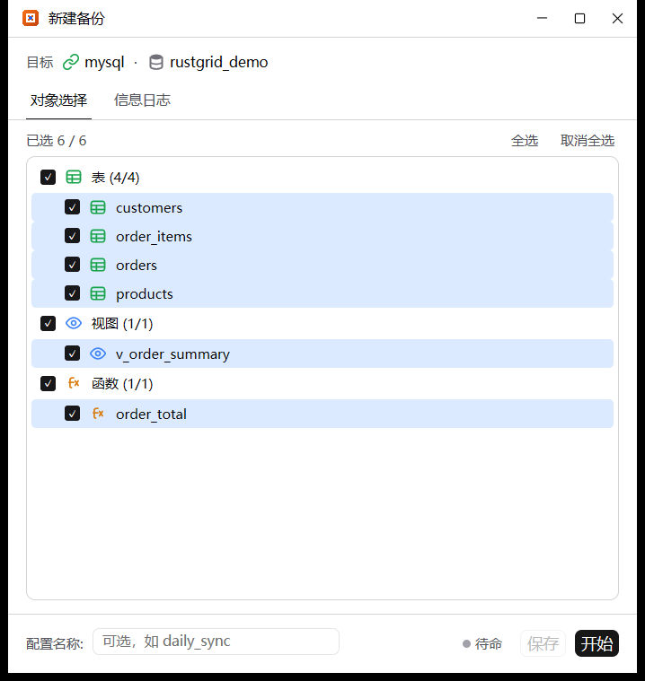

# 备份

RustGrid 自己的备份格式是 `.rgbak`：一个文件同时包含结构和数据，内部是压缩块加 JSON 清单。

## 新建备份

1. 选中数据库，打开 **备份** 主标签页。
2. 点击 **新建备份**，窗口会带上该连接和数据库。
3. 在 **对象选择** 中勾选要包含的表和视图；**全选** / **取消全选** 可以快速处理大库。
4. 想复用同一批对象时填写配置名称，然后点击 **开始**。

**信息日志** 会显示对象数、记录数、实时消息、耗时以及最终成功/失败统计；完成后进度条变为绿色。

## 还原与提取

- **还原备份** 把选中的备份写回指定数据库。
- **提取 SQL** 把备份转换成可读脚本，便于审阅或交给其他工具。
- 保存的配置保留目标和对象选择，下次从备份列表重新打开即可执行同一个任务。

## 备份列表

- 每个备份显示名称、修改日期、文件大小和备注，点击表头可以排序。
- `F2` 重命名备份，工具栏删除前会确认，复制/粘贴可以移动备份文件。
- 备份文件按数据库保存在 RustGrid 配置目录中。

## 说明

- 备份/还原覆盖 MySQL/MariaDB、PostgreSQL、SQL Server、Oracle 和 SQLite。ClickHouse、Redis 和 MongoDB 在当前版本不提供 `.rgbak` 备份。
- 在执行 **同步**、大批量导入或破坏性表变更前先做一次备份。文件同时包含结构和数据，可以跨机器、跨同引擎版本恢复。
