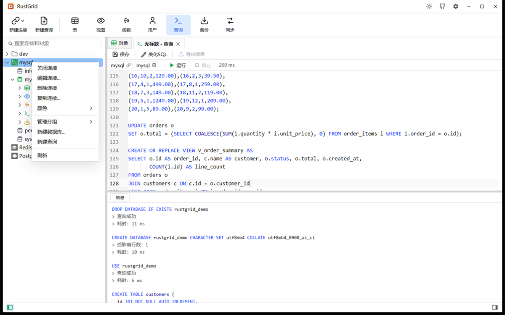
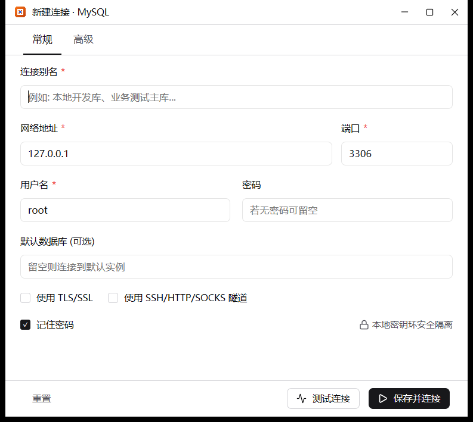
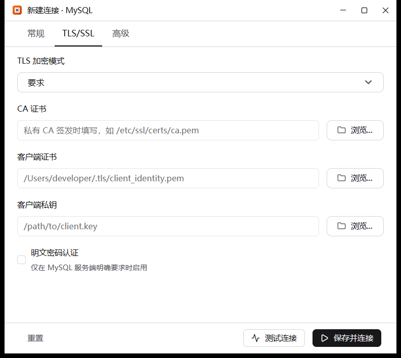
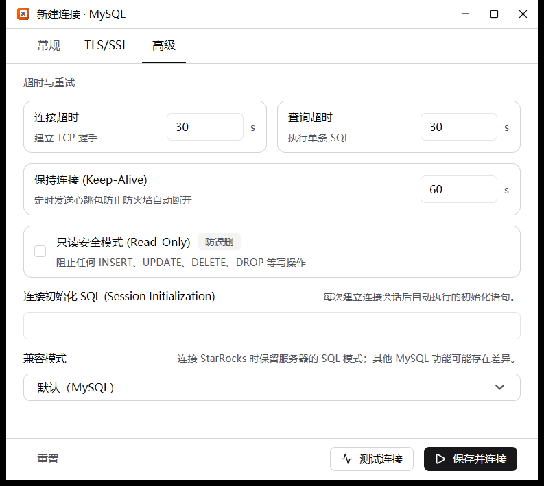

# 连接

左侧连接树是一切的起点：连接、分组和标记服务器，然后展开数据库和对象。

## 新建连接

1. 点击 **新建连接**，选择数据库类型。菜单末尾还有 **导入连接** 和 **导出连接**。
2. 填写连接表单。连接名、主机和端口必填，数据库可选。
3. 先点 **测试连接** 做一次安全检查（走隧道时尤其有用），再点 **保存并连接** 保存配置并立即打开。

- **记住密码** 会把密码存入加密密钥库。不勾选时每次打开连接都会询问密码，密码永远不会写进 `connections.json`。
- 引擎自己的字段位于常规页：Oracle 的服务名 / SID / TNS 别名、SQL Server 的验证方式和应用程序名、SQLite 的文件路径和 SQLCipher 模式、Redis 的键列表上限，以及 ODBC 驱动或连接字符串。
- 用户名默认使用引擎自己的账户（`root`、`postgres`、`sa`），没有惯用账户的引擎则留空。

## TLS 与隧道

两者都是常规页上的 **开关**，只有打开后才会出现对应页面。

- **使用 TLS/SSL** 打开 TLS 页：加密模式（优先 / 要求 / 验证）、CA 证书、客户端证书、客户端私钥，以及 MySQL 的明文密码认证选项。MySQL、MariaDB、PostgreSQL、SQL Server、Oracle、ClickHouse 和 MongoDB 都支持。
- **使用 SSH/HTTP/SOCKS 隧道** 打开隧道页。驱动连接的是本地转发端口，服务器地址由隧道端解析。密码和密钥属于连接配置，不会显示在连接树里。

## 高级设置

**高级** 页放的是所有网络引擎都遵守的通用参数：

- 连接超时和查询超时（秒）。
- 保持连接（Keep-Alive），防止防火墙悄悄断开空闲会话。
- **只读安全模式**，对该配置阻止 INSERT、UPDATE、DELETE 和 DROP。
- **连接初始化 SQL**，每次建立新会话后执行。
- 驱动支持的兼容模式（例如 MySQL 的 StarRocks 模式）。

## 管理连接树

- **分组**：右键连接树空白处，选择 **新建分组**。把连接拖进分组，或使用 **管理分组 → 移动到**。分组可以任意嵌套；**从分组内排除** 把连接移回根节点。删除分组会把子项上移一级，不会删除连接。
- **颜色**：连接右键菜单提供 **颜色 → 红 / 黄 / 绿**。颜色会画在整个子树以及该连接的所有标签页上，生产库一眼可辨。再次选择当前颜色即可清除。
- **搜索**：顶部搜索框会过滤分组、连接、数据库、模式和表。支持限定名：`orders` 匹配表，`sales.orders` 匹配模式 + 表，`db.sales.orders` 匹配完整名称。**Down** / **Up** 可以把焦点从搜索框移到结果列表。
- **刷新** 会重新读取数据库列表和每个已打开数据库的对象。在 RustGrid 之外建的表无需重连即可出现。

## 导入与导出

- **导入连接** 支持 RustGrid `.rgc`、Navicat `.ncx` 和 DBX JSON。`.rgc` 还会恢复分组及其顺序，其他格式平铺导入。密码会写入加密密钥库。
- **导出连接** 会打开一个小窗口：勾选连接、决定是否导出密码，然后保存为一个 `.rgc`。导出的密码是加密的，不会以明文出现。

## 断开与删除

- **关闭连接** 会关闭服务器以及针对它打开的所有账户和权限窗口，配置仍保留在连接树里。
- **删除连接** 在确认后删除配置，保存的密码也一并删除。
- **复制连接** 会复制出一个配置，适合为同一台服务器建立预发布副本。
