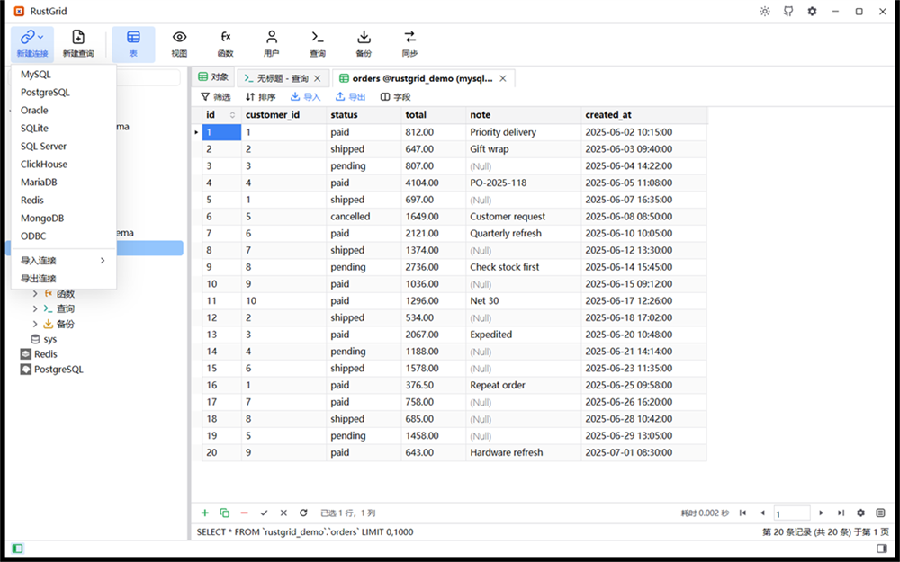

# 支持的引擎

RustGrid 提供多个原生驱动和一个通用 ODBC 驱动，全部共用同一套界面。每个驱动声明自己支持的能力，因此引擎做不到的操作会直接隐藏，而不是到最后才失败。

## 引擎与能力

| 连接类型 | 提供的能力 |
| --- | --- |
| **MySQL / MariaDB** | 表、视图、存储函数和过程、账户与权限、表设计器和 `.rgbak` 备份。 |
| **PostgreSQL** | 模式、表、视图、函数 / 过程、角色与 ACL、表设计器和备份。对象名带模式限定。 |
| **SQL Server** | 模式、表、视图、过程 / 函数、登录名与角色、表设计器和备份。Windows 构建支持 Windows 身份验证。 |
| **Oracle** | 模式、表、视图、函数 / 过程 / 包 / 触发器、用户与角色、设计器和备份。可用服务名、SID 或 TNS 别名连接。 |
| **SQLite** | 单个数据库文件，支持 SQLCipher 4 和 SQLCipher 3 加密。没有服务器账户、例程或事件。 |
| **ClickHouse** | 通过 HTTP 接口访问数据库、表和视图。网格只读；设计器可以编辑字段、默认值和注释。 |
| **Redis** | 编号数据库、键命名空间、字符串、哈希、列表、集合、有序集合和流。每个键有独立页面，并显示 TTL 和内存。 |
| **MongoDB** | 数据库、集合和文档。一个文档就是网格的一行，`_id` 是主键，行表单提供 JSON 视图。 |
| **ODBC** | 任何已安装的 ODBC 驱动；表设计器关闭，因为通用驱动无法忠实还原索引和选项。 |

通用 ODBC 驱动是没有原生 Rust 驱动时的兜底方案，例如 DB2、达梦等。它从连接的 `odbc.engine` 读取引擎类型，再套用该引擎的标识符引号、分页和字面量规则。

## 连接树差异

- **模式引擎**：SQL Server、PostgreSQL 和 Oracle 显示数据库 → 模式 → 表 / 视图 / 函数 / 查询 / 备份。
- **无模式引擎**：MySQL、MariaDB 和 SQLite 从数据库直接到对象。
- **Redis** 用命名空间文件夹代替 SQL 分类，数据库行本身就是全部键视图。
- **MongoDB** 把对象叫作 **集合**，并用集合对话框代替 SQL 设计器。

## 由能力驱动的界面

用户、函数、备份和设计器标签只在驱动支持时出现。同一条规则也会隐藏只读网格上的编辑操作：

- ClickHouse 没有唯一行键，更新 / 删除会被拒绝，编辑按钮隐藏；导入仍然可用。
- 查询结果能映射到单张表时可编辑；连接多张表时只读，双击打开单元格查看器。
- Redis 键页面有自己的编辑器，不使用 SQL 网格；流和 ReJSON 键是只读的。

## 连接字段

每个驱动声明自己的连接表单。常规页放标准的主机 / 端口 / 用户 / 密码字段，引擎再补充自己需要的内容：Oracle 的服务名、SID 或 TNS 别名；SQL Server 的验证方式和应用程序名；SQLite 的文件路径和加密模式；Redis 的键列表上限；MongoDB 的认证数据库；ClickHouse 的 HTTP / HTTPS 端口。

连接表单、TLS 和隧道页见 [连接](./connections.html)，各引擎的设计器标签见 [表设计器](./table-designer.html)。
