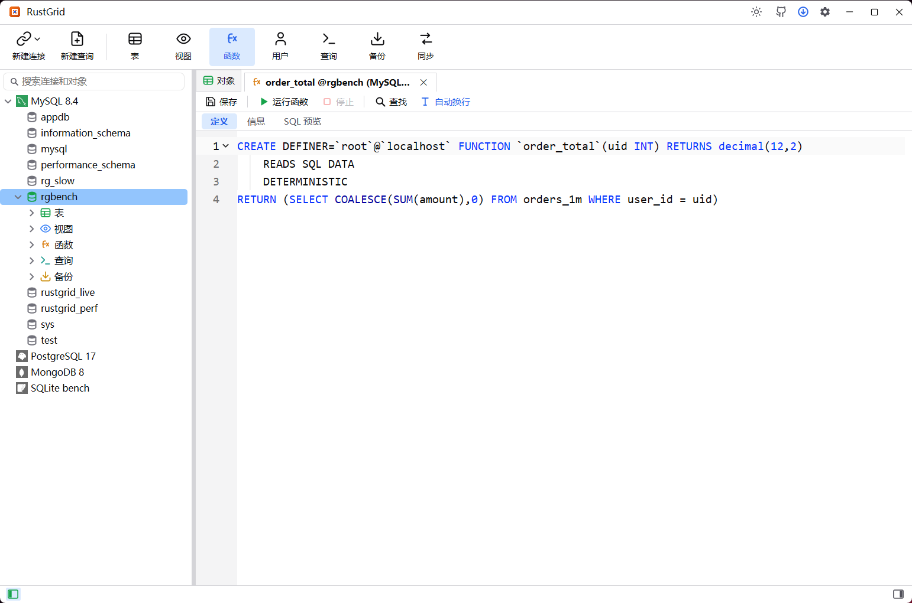

# 函数

函数和存储过程按数据库列出，并在与查询共用的 SQL 编辑器中编辑。

## 函数列表

- 列表显示函数名、修改时间、类型（函数或存储过程）、是否确定性以及注释。可以搜索，也可以切换平铺网格和详细列表。
- **设计函数** 打开选中项；**新建函数** 从模板开始；**删除函数** 需确认；**运行函数** 直接执行。
- 连接树的 **函数** 分类提供相同操作，不打开主标签页也能进入函数。

## 函数编辑器

- **定义** 是从引擎读取的完整 `CREATE` 语句，可编辑，并带语法高亮、查找和自动换行。
- **信息** 显示函数类型、返回类型、定义者、数据访问方式、确定性、SQL 模式、字符集和排序规则。
- **SQL 预览** 是 **保存** 将要执行的脚本。
- **保存** 会删除原函数并重新执行编辑后的 `CREATE`，函数体、参数和属性都通过这条路径修改。`Ctrl+S` 保存。
- **运行函数** 会把函数包装成 `SELECT`、把存储过程包装成 `CALL`，在新的查询标签页中打开。无参数的函数会立即执行；有参数时保留调用语句供填写。

## 说明

- 标签页标题保留函数所属的数据库和连接，可以同时打开多个函数。
- 存储函数/过程适用于 MySQL/MariaDB、PostgreSQL、SQL Server 和 Oracle。SQLite、ClickHouse、Redis 和 MongoDB 没有存储过程，分类会自动隐藏。
