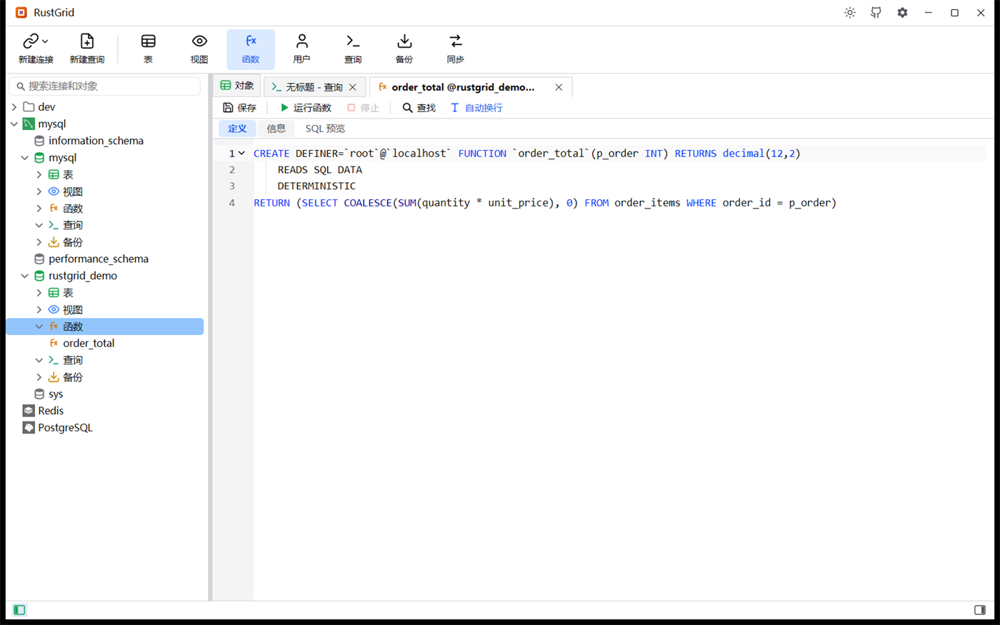
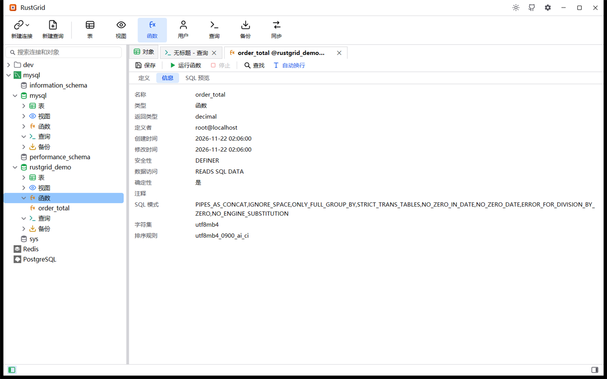

# 函数与存储过程

存储例程按数据库列出，并在与查询相同的 SQL 编辑器里编辑。页面叫“函数”，但同时覆盖存储过程和包。

## 列表

- 列表显示例程名、修改时间、类型（函数或过程）、是否确定性和注释。使用搜索框，或在平铺 / 详细布局之间切换。
- **设计函数** 打开选中的例程；**新建函数** 从模板开始；**删除函数** 需要确认；**运行函数** 执行它。
- 连接树有 **函数** 分类，操作相同，不切换主标签也能打开例程。
- Oracle 的包和触发器也归在这个分类里。

## 例程编辑器

- **定义** 是引擎返回的完整 `CREATE` 语句，支持语法高亮、查找和自动换行。
- **信息** 显示例程类型、返回类型、定义者、数据访问方式、确定性、SQL 模式、字符集和排序规则。

- **SQL 预览** 是 **保存** 将执行的脚本。
- **保存** 删除原例程并重放编辑后的 `CREATE`。函数体、参数和属性就是这样修改的。**Ctrl+S** 保存。
- **运行函数** 把函数包进 `SELECT`、把过程包进 `CALL`，然后在新查询标签里打开调用。无参数例程会立即运行；有参数的会留下调用模板等待填写。

## 说明

- 标签标题保留例程的数据库和连接，因此可以并排打开多个例程。
- 例程支持 MySQL/MariaDB、PostgreSQL、SQL Server 和 Oracle。SQLite、ClickHouse、Redis 和 MongoDB 没有存储例程，分类会自动隐藏。
- 引用了已删除对象的例程仍可打开；错误会在运行或服务器重新校验时出现。
- 和查询标签不同，保存例程会立即修改服务器。生产环境修改前请先做 [备份](./backup.html)。
