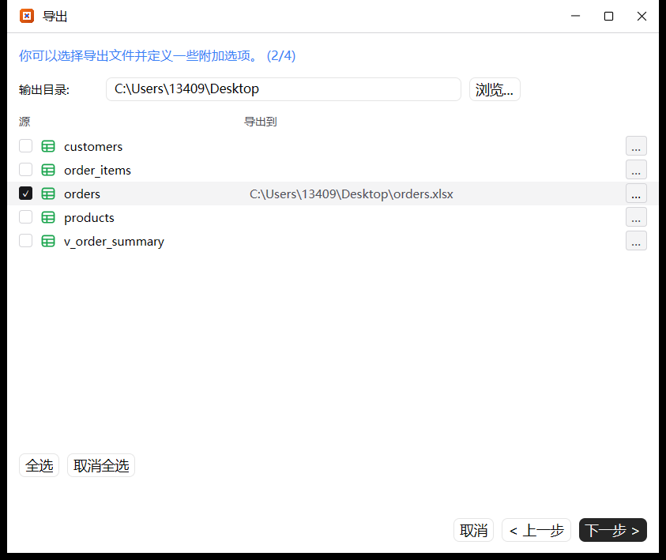

# 导入与导出

两个向导可以在不手写 SQL 的情况下搬数据。它们都是独立窗口，因此原生文件选择框不会阻塞主工作区。

## 导入

表工具栏或表右键菜单里的 **导入** 打开四页向导：

1. **导入类型**：Excel（`.xlsx`、`.xls`、`.xlsm`、`.xlsb`、`.ods`）、CSV 或文本。
2. **源文件**：选择文件。每个工作表（CSV/TXT 则是整份文件）成为一行，可编辑目标表名，并带 **创建表** 勾选框。
3. **字段映射**：每个源列对应一个目标字段，按规范化后的表头名自动匹配。未匹配的列不会导入。
4. **运行**：按批次插入，日志显示进度和逐行错误。

- 源表名与现有表匹配时导入到该表；否则名称成为新表，并自动勾选 **创建表**。
- 新建表的字段和类型由数据推断：整数 → `bigint`，小数 → `decimal(20,6)`，日期 → `date` / `datetime`，布尔 → `tinyint(1)`，文本 → `varchar` / `longtext`。`id` 列会成为主键。
- 日期时间按“日在前”的格式解析，因此 `26/6/2025` 是 6 月 26 日，并改写为引擎的标准格式。
- 格式错误的行会写进日志；**遇到错误时继续** 决定是否继续执行。

## 导出

**导出** 打开四页向导，支持 `.xlsx`、`.csv`、`.sql` 和 `.txt`：

1. **格式**：选择输出类型。
2. **表与路径**：勾选要导出的表，设置每个输出路径。原生文件夹 / 文件对话框默认从桌面开始。
3. **字段**：选择每张源表要导出的列，默认全选。
4. **选项与运行**：选择是否包含列标题、出错是否继续，然后 **开始**。日志显示总数 / 已处理行数、耗时和最终结果。

- 网格自己的 **导出** 会先询问 **全部记录** 还是 **当前 N 条记录**。当前页导出使用屏幕上的这些行，带上已应用的筛选和排序，不会重新读取表。
- 表导出按主键分页读取，偏移量稳定；没有主键的表按引擎自然顺序导出。
- 查询结果可以导出多个结果集。选中多个时会写入同一个 `.xlsx` 工作簿，每个结果一个工作表；其他格式每个结果一个文件。
- **SQL** 输出包含可在同种引擎上重放的 `INSERT` 语句。需要同时带结构时，请使用 [备份](./backup.html)。

::: tip 大文件
导出会流式读取行，但 `.xlsx` 要等工作簿写完才落盘。非常大的表用 CSV 或 SQL 输出更省内存，也可以按页分批导出。
:::
