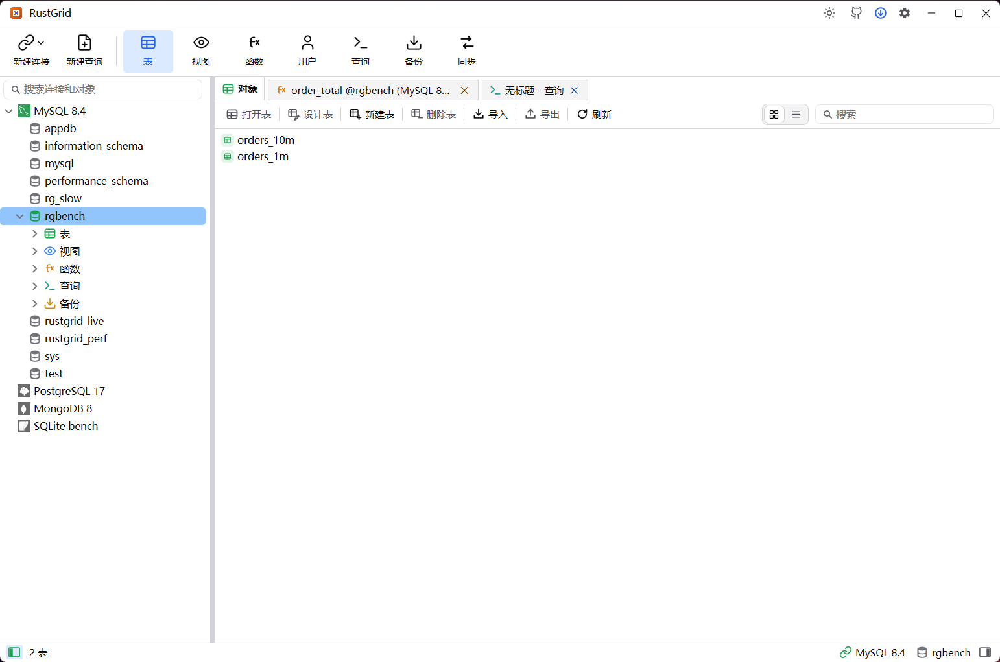

# 快速开始

从 [Releases](https://github.com/yisier/rustgrid/releases/latest) 下载对应平台的压缩包，解压后直接运行 `RustGrid`。没有安装程序，也不依赖运行时。

## 新建连接

1. 点击 **新建连接**，选择数据库类型。
2. 填写主机、端口、用户名和密码。SQLite 填写文件路径；ODBC 填写驱动或连接串。
3. 点击 **测试连接**，然后 **保存并连接**。

连接树集中显示数据库、表、视图和已保存的查询。连接可以分组、按环境着色，整棵树支持搜索。

## 支持的数据库

| 类型 | 数据库 |
| --- | --- |
| SQL | MySQL、MariaDB、PostgreSQL、SQL Server、Oracle、SQLite、ClickHouse |
| NoSQL | Redis、MongoDB |
| 通用 | ODBC（DB2、达梦等） |

## 平台

Windows 10+、macOS 13+（Intel 与 Apple Silicon）、Linux x64 / arm64。macOS 安装包未签名，首次打开请右键选择“打开”。
