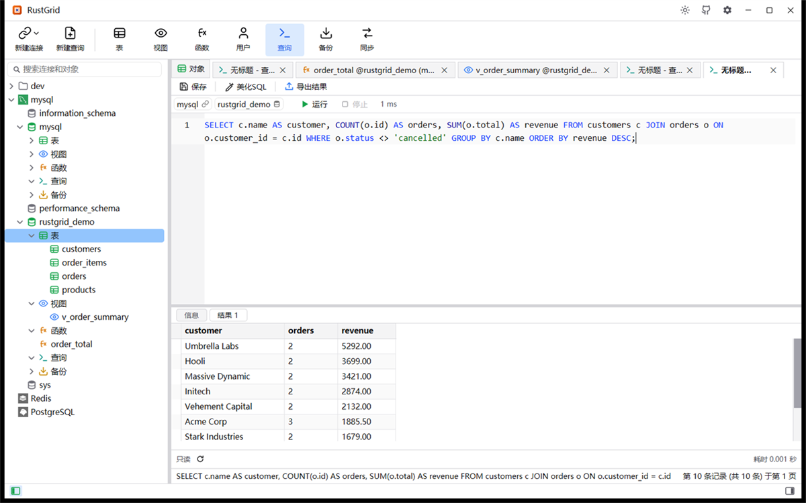

# 查询

查询编辑器是一个完整的 SQL 工作区：编写、美化、运行，并把结果保留为可编辑网格。

## 新建查询

- **新建查询**（或 **Ctrl+Q**）打开一个编辑器标签。它使用连接树当前选中的连接和数据库；两者都可以在标签自己的工具栏里修改。
- 连接 + 数据库属于该标签，所以不同标签可以面向不同服务器。
- 从连接分组打开的 **组查询** 会让同一段 SQL 在组内每个成员上运行，并为每个连接提供独立的结果页。

## 编写与运行

- 语法高亮、关键字 / 表名补全（**Ctrl+Space**）、**美化SQL**、**解释**、查找（**Ctrl+F**）、行号和自动换行。
- **Ctrl + 鼠标滚轮** 缩放编辑器。**选项 → 编辑器** 里的字体、行号和换行设置会作用到已经打开的编辑器。
- **Ctrl+R** 运行脚本；**Ctrl+Shift+R** 或 **Ctrl+Enter** 运行选中部分。单次语句上限和出错是否继续在 **选项 → 常规**。
- 多语句脚本在同一个固定会话上执行，因此 `SET`、事务和 `USE` 在驱动支持时能跨语句生效。

## 结果

- 每条返回结果集的语句都会在 **信息** 旁生成一个 **结果 N** 标签；点击切换网格。结果标签太多时标签栏会横向滚动，并出现 ◀ / ▶。
- 结果网格和表网格共用控件：排序、筛选、字段布局、复制和导出。能映射到单张表的结果可以直接编辑；否则双击打开只读单元格查看器。
- 查询结果在客户端分页：整个结果由标签持有，翻页不会重新执行语句。
- **导出结果** 可以导出一个结果集，或把多个选中的结果写入同一个 `.xlsx` 工作簿（每个结果一个工作表）。其他格式每个结果一个文件。

## 保存与复用

- **Ctrl+S** 保存查询。已经保存过的标签直接覆盖文件，不会询问；新标签会询问名称以及连接 / 数据库位置。
- **查询** 主标签列出保存的查询：名称、连接、数据库三列。列表跟随连接树的选择：选中数据库只显示该库的查询，选中连接显示它的所有数据库，其他选择显示全部。点击表头排序，双击打开，**F2** 重命名，工具栏删除。
- 保存的查询存放在配置目录的 `queries/` 下，恢复时尽量绑定回原连接。

## 组查询

- 在连接树选中一个分组，选择 **新建查询**（或使用分组右键菜单）。编辑器的 **信息** / 连接标签会为每个服务器显示一页。
- 没打开的成员会为本次运行而连接，但不会展开它的树节点。缺少密码、连接失败或 SQL 出错都会显示在该服务器自己的页面上，不会阻塞其他服务器。
- 组查询不选择数据库：每个连接在自己的默认上下文里执行，因此与数据库无关的语句可以直接运行，`USE` 或完全限定名可以按服务器指定数据库。
- 保存的组查询位于 `queries/_groups/<group-id>/`，当分组或它的某个成员被选中时，会作为组标签重新打开。

::: tip 大脚本之前
先用 **解释** 检查执行计划；支持事务 DDL 的引擎，把破坏性语句包在事务里。查询标签不会为数据修改保留撤销历史。
:::
