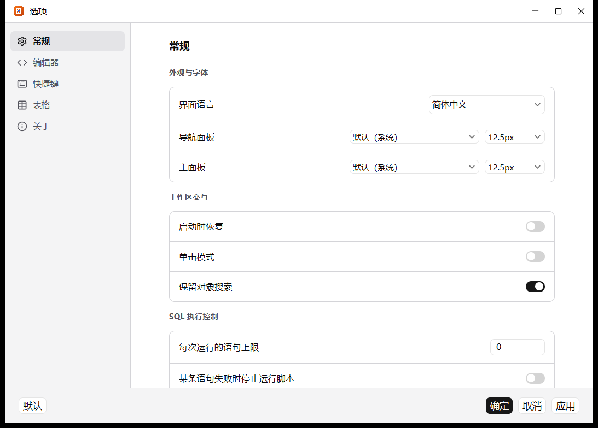

# 设置

点击标题栏的齿轮图标打开 **选项**。窗口内的修改先作为草稿保留，点 **应用** 或 **确定** 才生效；**取消** 丢弃修改，**默认** 恢复内置值。

## 常规

- **界面语言** 立即切换菜单和提示信息。
- **导航面板** 和 **主面板** 设置连接树、标签栏、状态栏和对话框的字体与字号。
- **启动时恢复** 重新打开上次的查询标签、连接、数据库和表标签。
- **单击模式** 用单击打开连接和对象；关闭时与 Navicat 一样使用双击。
- **保留对象搜索** 在切换标签、数据库或连接时保留每个列表的搜索内容。
- **每次运行的语句上限** 限制一次运行的多语句脚本（0 表示不限制）；**某条语句失败时停止运行脚本** 在第一条失败语句处停止。

## 编辑器

- 设置字体和字号，并提供实时预览。
- **显示行号** 和 **自动换行** 会立即作用于所有已打开的查询编辑器，而不只是新编辑器。
- **Ctrl + 鼠标滚轮** 只临时缩放当前编辑器，不改变设置本身。

## 表格

- **数据网格字体** 控制表页面和查询结果中的单元格字体。
- **展示备注** 与 **展示类型** 会在列名下方增加一行或两行说明。两者默认关闭，避免表头过高。
- **离开行时保存修改** 使用 Navicat 的记录模型：`Enter` 和 `Tab` 只暂存单元格，用 `Up` / `Down` 或点击其他行离开时才写入。关闭后可以自行收集修改再按 `Ctrl+S`。

## 快捷键

按名称搜索命令，点击命令后记录新的组合键；重置操作会恢复该命令的默认按键。搜索框覆盖所有命令分组。

## 关于

显示当前版本、检查 GitHub 上是否有新版本，并展示该版本的更新日志。站点自身的更新与客户端版本是分开的。

设置和快捷键绑定保存在 `settings.json`，密码不会写入其中。**本站** 首次访问会根据浏览器语言自动选择——默认英文，浏览器为中文时进入中文站——并在语言菜单中记住手动选择。
