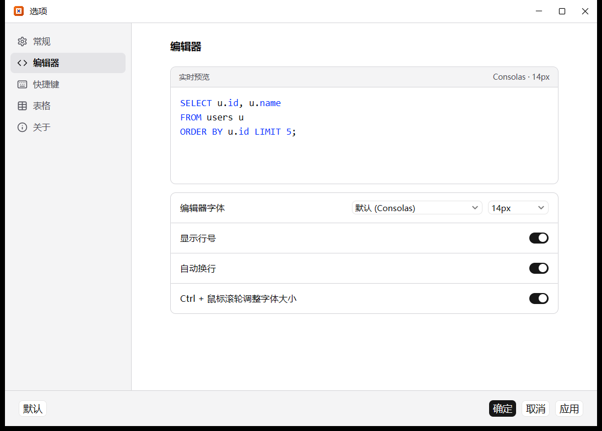
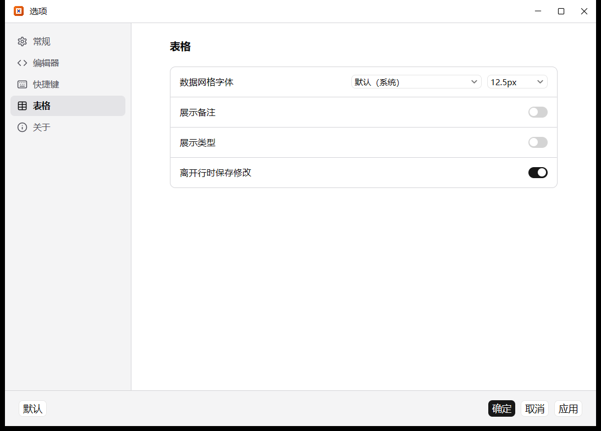
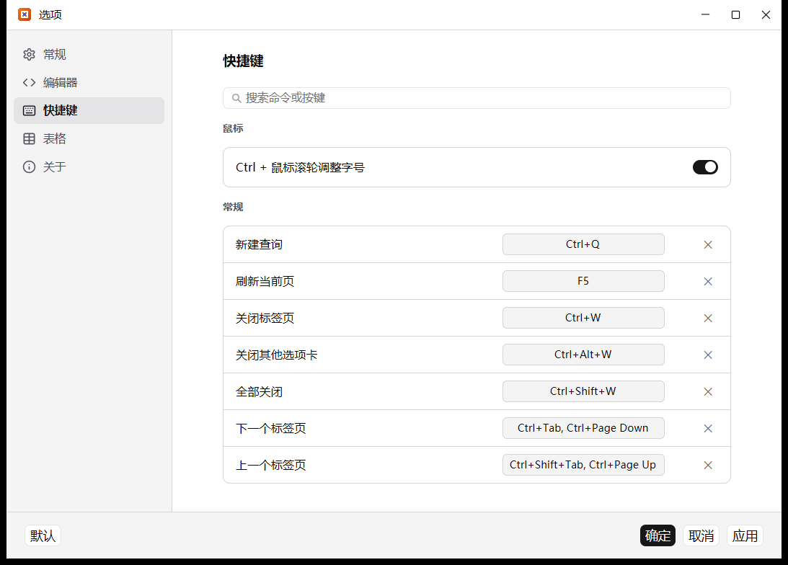

# 设置

从标题栏的齿轮打开 **选项**。窗口里的修改先保存在草稿中，点 **应用** 或 **确定** 才生效；**取消** 丢弃，**默认** 恢复内置值。

窗口本身刻意保持简洁：每行只显示选项名和控件。下面说明每个选项的作用。

## 常规

配置界面语言、字体和查询执行行为。

### 外观与字体

- **界面语言** 立即改变菜单和提示的显示语言，提供 English、简体中文和 Русский。
- **导航面板** 设置连接树和对象列表的字体与字号。
- **主面板** 设置标签栏、状态栏和对话框的默认字体。

### 工作区交互

- **启动时恢复** 在下次启动时恢复查询标签、连接、已打开的数据库和表标签。关闭后启动干净，连接树从折叠状态开始。
- **单击模式** 让连接、数据库、表和其他对象单击即打开；默认关闭，保持 Navicat 的双击习惯。
- **保留对象搜索** 在切换标签、数据库或连接时保留每个列表自己的搜索（表、视图、函数、查询）。点击主标签仍会清除该标签的搜索。

### SQL 执行控制

- **每次运行的语句上限** 一次最多运行这么多语句，其余跳过并提示。`0` 表示不限制。
- **某条语句失败时停止运行脚本** 多语句脚本在第一条失败语句处停止。

## 编辑器

自定义 SQL 编辑器的字体和交互。修改会作用到已经打开的编辑器，不只是新打开的。

- **编辑器字体** 和 **字号** 选择查询编辑器使用的字体。等宽字体能让字段和对齐更整齐。
- **显示行号** 在编辑器左侧显示行号栏。
- **自动换行** 在编辑器可见宽度处折行。
- **Ctrl + 鼠标滚轮调整字体大小** 按住 Ctrl 在查询编辑器上滚动即可缩放；普通滚轮仍然是滚动编辑器。

## 表格

控制数据网格和表设计器如何展示列。

- **数据网格字体** 设置查询结果和表数据的单元格字体。
- **展示备注** 在网格表头的列名下显示字段注释。
- **展示类型** 在表头显示字段的数据类型（例如 `VARCHAR`、`INT`）。
- 这两个表头附加行默认关闭，因为每多一行都会让表头更高。
- **离开行时保存修改** 在离开一行（**Up** / **Down** 或点击另一行）时保存该行；**Enter** 和 **Tab** 只暂存单元格。跨多个单元格的修改、粘贴或填充会等待 **保存**。关闭后可以自行收集修改再按 **Ctrl+S**。

## 快捷键

按名称或按键搜索命令，点击命令的按键框后按下新组合（**Esc** 取消）。`↺` 恢复该命令的默认绑定，`✕` 清除绑定。

- **Ctrl + 鼠标滚轮调整字号**：按住 Ctrl 在导航面板、主面板或表格上滚动，缩放对应字体。
- 冲突会在列表里标出，两个命令不会悄悄共用同一个按键。

## 关于

显示当前版本、检查 GitHub 上的新版本，并展示该版本的更新日志。

设置和快捷键绑定保存在 `settings.json`，密码永远不会写进去。本站首次访问时会跟随浏览器语言（默认英文，中文浏览器显示中文），并从语言菜单记住手动选择。
