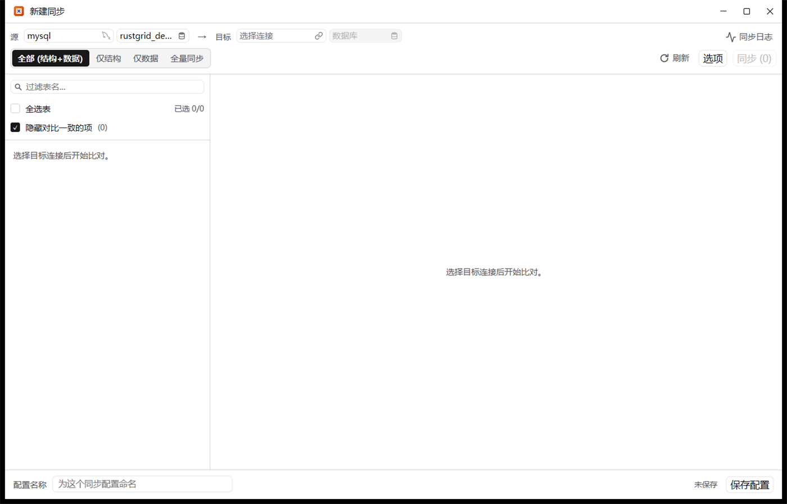

# 同步

同步比较源数据库和目标数据库，只写入你确认过的差异。

## 建立比较

- 顶部选择源和目标 **连接**、**数据库**。箭头从源指向目标。
- 选择模式：**全部（结构 + 数据）**、**仅结构**、**仅数据** 或 **全量同步**。
- 表列表显示每张表及其差异数量。使用过滤框、**全选表** 和 **隐藏对比一致的项** 聚焦到有变化的部分。

## 审阅差异

- 选中一张表，查看 **结构**、**数据** 和 **SQL 预览**。
- **结构** 显示字段和索引差异。**数据** 按 **Insert**、**Update**、**Delete** 分组显示主键和变化的值。没有主键的表标记为 **无主键**。
- **重新比较** 在任一侧变化后刷新该表；**同步日志** 记录运行过程。
- 操作标签可以过滤行列表：全部、插入、更新或删除。

## 执行同步

- **同步** 把选中的模式应用到目标。目标含生产数据时，先阅读 SQL 预览。
- 底部的配置名称可以保存，之后再打开，和备份配置一样。
- 没有主键的表没有可靠的行标识。同步会给出警告而不是猜测，请先给这类表加上主键。

## 建议做法

- 先在副本上比较，或者先对目标做一次 [备份](./backup.html)。
- 结构变化可能删除或修改字段，确认前一定要看 SQL 预览。
- 日常刷新用 **仅数据**，从零补齐目标时用 **全部**。
- 同步是对目标的写操作；源库只读。
