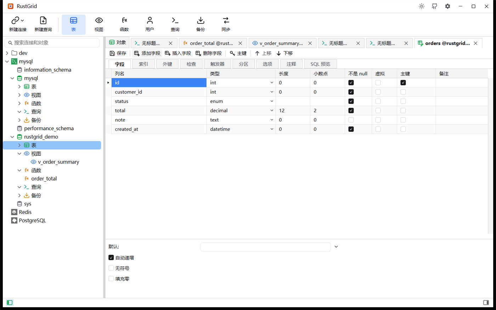
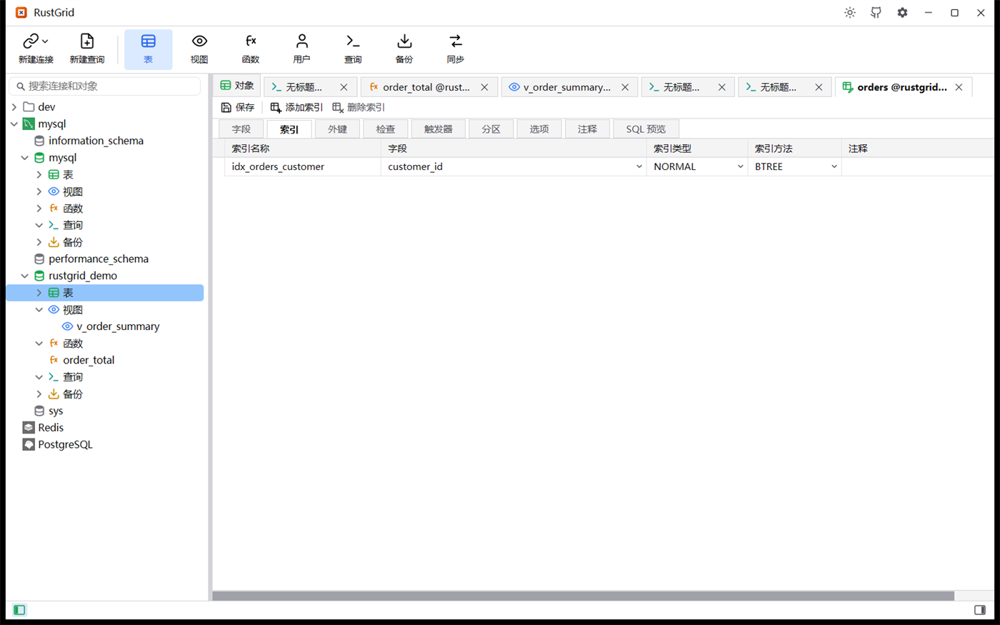

# 表设计器

表设计器用来修改表结构，并在任何语句到达服务器之前显示准确的 SQL。可从对象列表、表右键菜单或连接树里的 **设计表** 打开。

## 布局

- 顶部标签是表的各个部分：**字段**、**索引**、**外键**、**检查**、**触发器**、**分区**、**选项**、**注释** 和 **SQL 预览**。引擎只显示它真正支持的标签。
- 字段网格是主编辑器：列名、类型、长度、小数点、`不是 null`、虚拟、主键和备注。
- 网格下方的详情面板编辑选中字段的默认值、自动递增、无符号和填充零。MySQL/MariaDB 还提供枚举值编辑器和排序规则。
- 工具栏提供 **添加字段**、**插入字段**、**删除字段**、**复制字段**、**主键**、**上移** 和 **下移**。新字段追加在选中行之后。

## 编辑字段

1. 按 **Insert** 或点 **添加字段**，直接开始输入字段名。
2. 从下拉列表选择类型；列表里没有的类型可以直接输入，例如 `varchar(80)` 或 `int unsigned`。
3. 填写长度 / 小数，勾选 `不是 null`、主键或引擎自己的选项。
4. **保存** 会把差异编译成 `ALTER TABLE` 语句。没有改动时显示 **暂无更改**。

**列名** 表头里的搜索框可按名称查找字段（**Ctrl+F** 会把光标放进搜索框）。选中一片单元格后输入，会把同一个值写入该列选中的每一行；粘贴文本也按同样方式填充选区。**复制字段** 会在末尾追加所选字段的副本（自动使用不重复的名称，并去掉主键、自动递增等标记）。

字段名为空或重复会加下划线，并在执行任何 SQL 之前阻止保存。纯字段重排也能识别：移动字段会生成 `MODIFY COLUMN ... FIRST / AFTER`，不会被误判为没有改动。

## 索引、键和检查

- **索引** 网格列出表的二级索引。主键不在这里占一行：它的名称和类型属于主键本身，字段就是 **字段** 页上的主键勾选。
- **添加索引** 新增一行；**字段** 单元格打开一个小编辑器，每列带自己的选项（所有引擎都有 **排序**，MySQL/MariaDB 还有 **前缀长度**）。**确定** 保留草稿，**取消** 丢弃。
- **外键** 把本地字段列表映射到被引用表及其字段，并设置更新 / 删除动作。
- **唯一键** 和 **检查** 只在支持的引擎上出现，SQL Server 两者都有。

## SQL 预览与保存

- **SQL 预览** 显示保存时将执行的准确脚本。没有改动时为空。
- 在设计器任意位置按 **Ctrl+S** 都能保存。设计器根节点有自己的按键上下文，所以字段网格有焦点时快捷键仍然有效。
- SQL Server 的 `ALTER COLUMN` 不能增加 identity，因此自动递增只允许用在新字段或新表上。

## 键盘操作

- **Tab** / **Shift+Tab** 在字段单元格之间移动：列名 → 类型 → 各引擎单元格 → 下一行。
- 方向键、**Home** / **End**、**Page Up** / **Page Down** 移动选中单元格。**Enter** 或 **F2** 打开编辑器；直接输入字符会以该字符开始编辑。
- **Ctrl+F** 打开字段搜索，**Insert** 添加字段，**Ctrl+Delete** 删除选中字段，**Ctrl+Up** / **Ctrl+Down** 移动字段。
- **F6** 在网格和详情面板之间切换。

## 安全建议

保存会执行一条或多条 `ALTER TABLE`。RustGrid 不会自动备份，修改大表或生产表之前请先做一次 [备份](./backup.html)。如果改动会删除字段、改变类型或重建索引，务必先阅读 SQL 预览。
