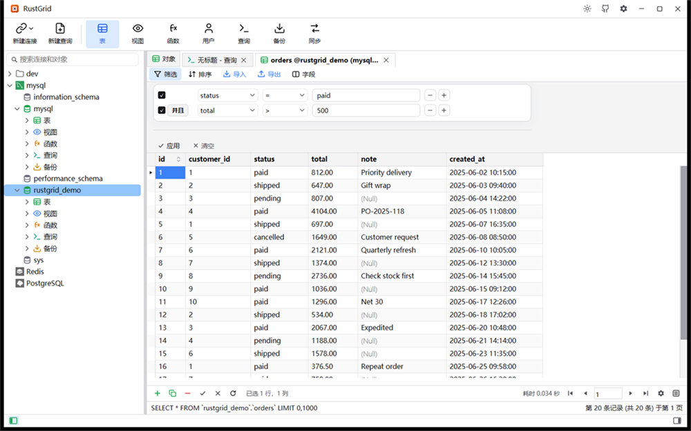
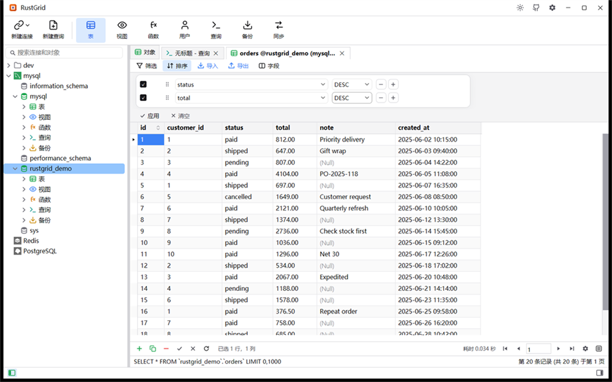
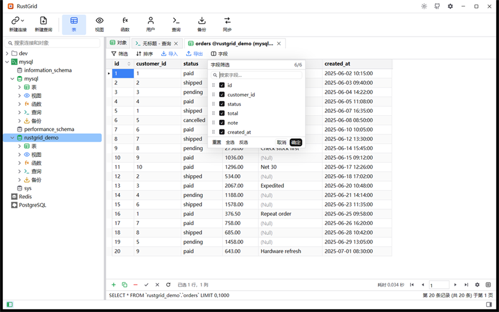
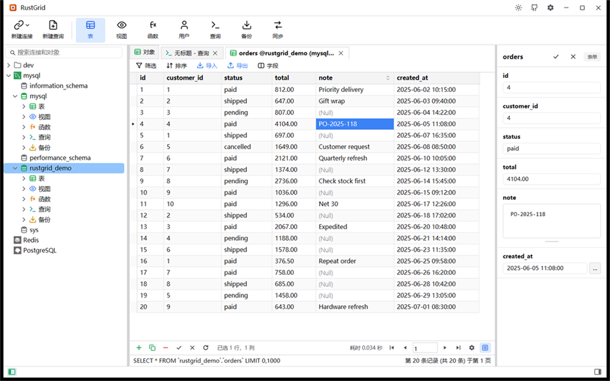

# 表与数据网格

表以分页数据网格的形式打开，可以直接在格子里编辑。它也是查看和修改数据的主要入口，查询结果和视图数据复用同一个网格。

## 打开与分页

- 在对象列表中双击表（或按 **Enter**）即可在新标签页打开。每个标签页保留自己的页码、筛选和排序。
- 默认每页 1,000 行。**限制记录** 面板提供 100 到 10,000 行或不限制；分页器显示总行数，并支持输入页码跳转。
- 分页默认按主键排序，所以翻页稳定；没有主键的表使用引擎的自然顺序。

## 查看

- 表头显示字段名。**选项 → 表格** 可以在名称下再显示字段类型和注释。
- JSON、长文本和二进制值在格子里只显示预览；**行表单** 显示完整内容，并提供 JSON 格式化开关和日期时间选择器。
- 页脚最右侧的 **表单** 按钮会把选中行展开成纵向表单，适合字段很多或值很长的表。

## 编辑

- 双击单元格，或按 **Enter** / **F2** 开始编辑。**Enter** 和 **Tab** 在单元格间移动，改动先暂存，不会立刻写库。
- 用 **Up** / **Down** 或点击另一行离开时，如果 **选项 → 表格 → 离开行时保存修改** 已开启，这一行会整体保存。**Ctrl+S** 可以立即保存。
- 工具栏的 `+` 追加新记录，**复制行** 在选中行下复制一条，删除操作移除选中行。新记录会显示字段默认值、`(Auto)` 或 `(Generated)`。
- 保存 / 放弃按钮旁会显示未保存数量；**Esc** 或 **放弃** 会先弹出确认。
- 没有主键的表会用全部字段定位一行，仍可编辑，但复制行会产生歧义。

## 筛选

**筛选** 打开树形条件构造器：条件可以用 **AND** / **OR** 分组，每个节点（包括整个分组）都有启用开关。

- 依次选择字段、运算符（`=`、`<>`、`<`、`>`、包含、开头 / 结尾等）和值。
- `+` 添加条件或分组；`−` 删除该行；分组之间的药丸按钮切换 AND / OR。
- **应用** 把条件树下发给引擎，分页和总数都基于筛选后的结果。**清空** 移除全部条件。
- 被禁用的节点会跳过但不会删除，方便保留稍后再用。

## 排序

**排序** 保存一组有先后顺序的字段。拖动规则左侧的手柄即可调整优先级，右侧控件切换升序 / 降序。

- **应用** 执行请求；**清空** 移除。
- 排序同样下发到引擎，所以第一页就是排序结果的第一页，而不是在客户端重新排列当前页。

## 字段布局

**字段** 打开字段筛选弹窗：搜索、勾选显隐、拖动调整顺序。

- 修改先保存在草稿中，点 **确定** 才生效；**取消** 或点击外部会丢弃。
- 布局按连接、数据库和表分别记住；之后表里新增的字段会追加到布局末尾，不会丢失。
- 右键列头可以使用 **冻结列**、**取消冻结**、**取消冻结全部列**、**隐藏列** 和 **刷新**。冻结的字段固定在左侧，其余字段在右侧滚动。

## 行表单

**表单** 按钮把选中行放到右侧窗格。每个字段变成带标签的编辑器，并显示类型和注释，宽表或长 JSON 文档比在横向网格里容易读得多。

- 输入的值会暂存到网格的待保存修改中；**Enter** 或 **Ctrl+S** 保存。
- **Esc** 恢复该字段在当前页里的原值。
- 时间字段有和网格单元格一样的 `…` 选择器；长文本或 JSON 值使用可拖拽调整高度的多行编辑器，并带格式化开关。

## 表操作

- **设计表** 打开 [表设计器](./table-designer.html)，包含字段、索引、外键、唯一键、检查和选项；**SQL 预览** 可以在保存前查看脚本。
- 对象右键菜单还提供 **重命名**（**F2**）、**清空表**、**截断表** 和 **删除表**；破坏性操作都会经过确认对话框。
- 详细列表会显示引擎提供的表概况：行数、数据长度、索引长度、引擎、排序规则、自动递增值和修改日期。
- **导入** 与 **导出** 打开 [导入导出向导](./import-export.html)，支持 Excel、CSV、TXT、SQL 和 `.xlsx`。
