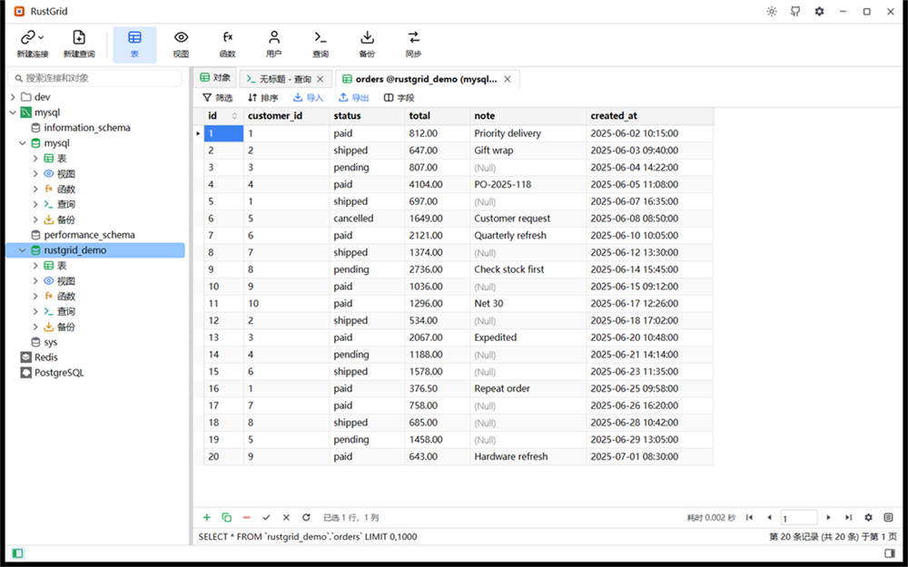

# 表

表页面是一个带分页的数据网格，可以直接在格子里编辑，是查看和修改数据的主要入口。

## 打开与分页

- 在对象列表中双击表（或按 `Enter` / 使用 **打开表**）即可在新标签页中打开。每个标签页保留自己的页码、筛选和排序。
- 默认每页 1,000 行。**限制记录** 提供 100 到 10,000 行或不限制；分页器显示总行数，并支持输入页码跳转。
- 分页默认按主键排序，所以翻页稳定；没有主键的表使用引擎的自然顺序。

## 查看

- 表头显示字段名；**设置 → 表格** 可以在名称下再显示字段类型和注释。
- JSON、长文本和二进制值在格子里只显示预览；右侧 **表单** 显示完整内容，并提供 JSON 格式化开关和日期时间选择器。
- 页脚最右侧的 **表单** 按钮会把选中行展开成纵向表单，适合字段很多或值很长的表。

## 编辑

- 双击单元格，或按 `Enter` / `F2` 开始编辑。`Enter` 和 `Tab` 在单元格间移动，改动先暂存，不会立刻写库。
- 用 `Up` / `Down` 或点击另一行离开时，如果 **设置 → 表格 → 离开行时保存修改** 已开启，这一行会整体保存。`Ctrl+S` 可以立即保存。
- 工具栏的 `+` 追加新记录，**复制行** 在选中行下复制一条，删除操作移除选中行。新记录会显示字段默认值、`(Auto)` 或 `(Generated)`。
- 保存 / 放弃按钮旁会显示未保存数量；`Esc` 或 **放弃** 会先弹出确认。
- 没有主键的表会用全部字段定位一行，仍可编辑，但复制行会产生歧义，删除时要注意。

## 筛选与排序

- **筛选** 是一棵树：条件可以用 `AND` / `OR` 分组，每个节点（包括整个分组）都有启用开关。
- **排序** 保存一组有先后顺序的字段；拖动规则左侧的手柄即可调整优先级。**应用** 执行请求，**清空** 移除。
- 筛选和排序会下发给引擎，分页与总数都基于筛选后的结果。

## 字段布局

- **字段** 打开字段筛选弹窗：搜索、勾选显隐、拖动调整顺序。修改先保存在草稿中，点 **确定** 才生效，关闭弹窗会丢弃。
- 布局按连接、数据库和表分别记住；之后表里新增的字段会追加到布局末尾，不会丢失。
- 右键列头可以使用 **冻结列**、**取消冻结**、**取消冻结全部列**、**隐藏列** 和 **刷新**。冻结的字段固定在左侧，其余字段在右侧滚动。

## 导入与导出

- **导入** 打开导入向导，支持 Excel、CSV 和 TXT：选择文件、把源列映射到目标字段、必要时新建表，然后分批插入。
- **导出** 打开导出向导，支持 `.xlsx`、`.csv`、`.sql` 和 `.txt`。网格上的导出会先询问是 **全部记录** 还是 **当前 N 条记录**（当前筛选、排序和页码）。
- 查询结果可以把多个结果集写入同一个工作簿；表导出每次写一张表。

## 表操作

- **设计表** 打开表设计器，包含字段、索引、外键、唯一键、检查和选项；**SQL 预览** 可以在保存前查看脚本。
- 对象右键菜单还提供 **重命名**（`F2`）、**清空表**、**截断表** 和 **删除表**；破坏性操作都会经过确认对话框。
- 详细列表会显示引擎提供的表概况：行数、数据长度、索引长度、引擎、排序规则、自动递增值和修改日期。
