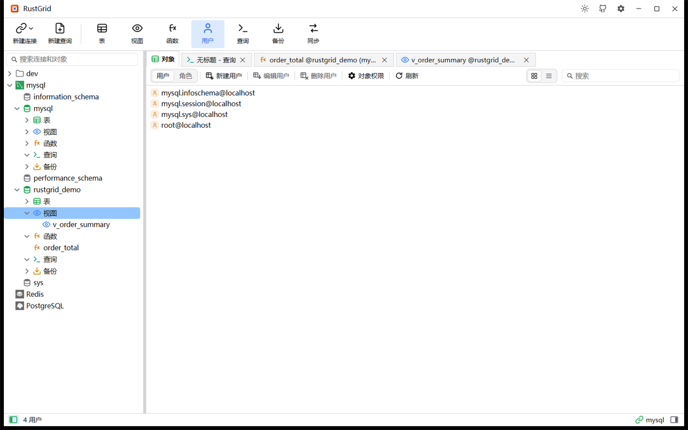
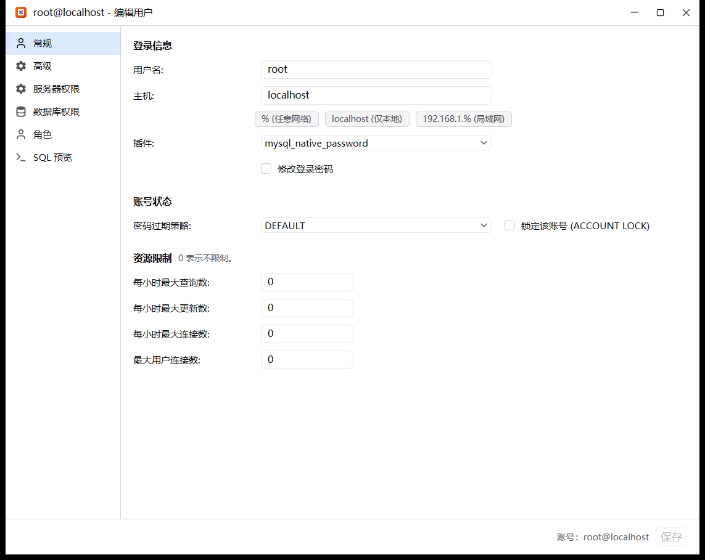

# 用户与权限

**用户** 主标签列出服务器账户。它支持 MySQL/MariaDB、PostgreSQL、SQL Server 和 Oracle；没有服务器账户概念的引擎会隐藏这个标签。

## 列表

- **用户** / **角色** 子标签在账户和角色之间切换。
- 工具栏提供 **新建用户**、**编辑用户**、**删除用户**、**对象权限** 和 **刷新**。搜索框过滤列表。
- 引擎允许时，**F2** 可以就地重命名账户。
- 关闭连接会同时关闭针对它打开的所有账户和权限窗口，不会留下编辑着已断开会话的窗口。

## 新建或编辑账户

**新建用户** 和 **编辑用户** 是同一个窗口。左侧导航包含五个部分，共用同一个编辑器：

1. **常规**：用户名、主机、认证插件、修改密码、锁定账户、密码过期策略和每小时资源限制。
2. **服务器权限**：全局 `*.*` 权限网格，带一键快捷模板。
3. **数据库权限**：左侧数据库列表，右侧是所选库的详情；可以授予全部表或指定表，带快捷模板和分组的细粒度权限。
4. **角色**：成员属于 / 成员列表；**集** 列用于授予 `WITH ADMIN OPTION`。
5. **SQL 预览**：保存将执行的脚本。

**保存** 对新建和编辑是同一条路径。修改用户名或主机会在脚本最前面生成 `RENAME USER`，因此账户会保留已有授权和角色关系。保存成功后会在原地重新加载账户。

## 对象权限

**对象权限** 打开所选账户的对象级权限管理器，列出账户可访问的数据库对象，并逐对象授予 / 回收权限。驱动暴露对象 ACL 时，对象列表里也能打开同一个管理器。

## 建议

- 连接时提示密码，密码不会保存进连接配置。
- 不要在没有第二个管理员会话的情况下修改当前登录账户；一次误操作的 `REVOKE` 可能把自己锁在外面。
- 保存角色或权限改动前先看 **SQL 预览**，预览就是保存时真正执行的脚本。
- MySQL 中只有 `GRANT USAGE ... WITH GRANT OPTION` 条目的数据库仍会出现在列表里；移除授权选项和移除数据库是两次不同的回收。
