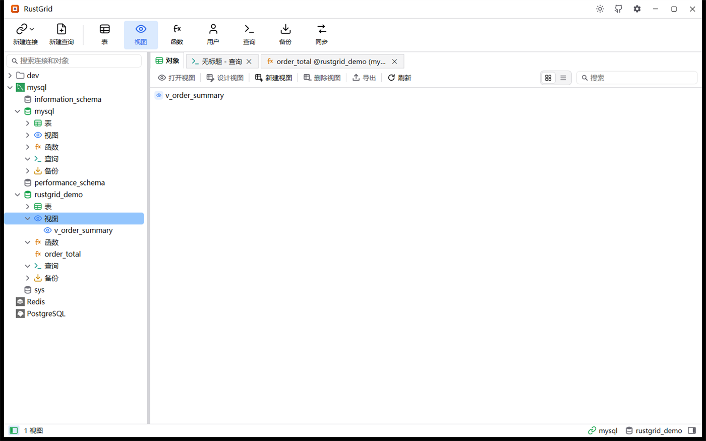
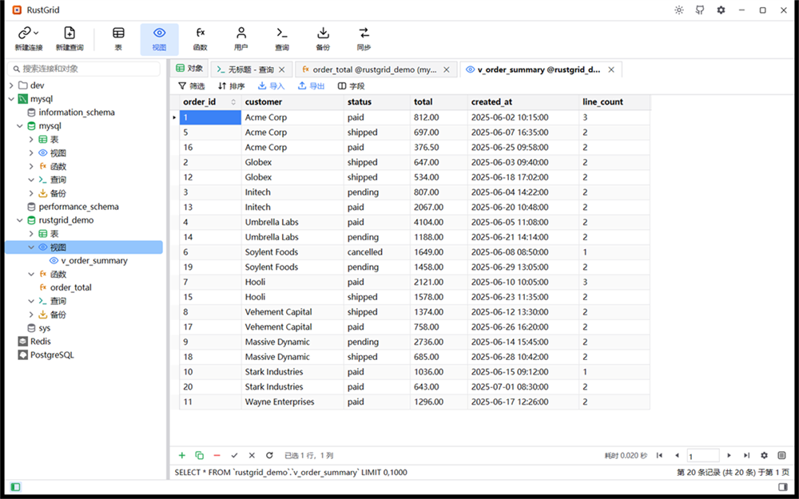

# 视图

视图按数据库列出，并和表一样在分页网格中打开。**视图** 主标签跟随连接树的选择，支持模式的引擎会显示所选模式的视图。

## 浏览与打开

- 双击视图打开它的数据；工具栏的 **打开视图** 作用相同，**Enter** 打开选中行。
- 引擎无法保证唯一行时网格是只读的；视图映射到单张表且驱动报告主键时可以直接编辑。
- 连接树里有 **视图** 分类，操作与主标签一致，因此不切换主标签也能打开视图。

## 设计视图

**设计视图** 以主内容标签打开视图设计器，复用 SQL 编辑器：

- **定义** 是引擎返回的完整可编辑 `CREATE ... VIEW` 语句。
- **高级** 保存定义者、安全类型、算法、检查选项、可更新性、时间戳和字符集 / 排序规则等引擎会报告的信息。
- **SQL 预览** 显示 **保存** 将执行的脚本。
- 工具栏提供 **保存**、**预览**、**解释** 和 **美化SQL**。

**保存** 从语句中解析视图名，删除原视图并通过连接重放编辑后的 `CREATE`。**预览** 在网格中打开已保存视图的数据；**解释** 对定义里的 `SELECT` 执行解释，并在设计器底部的 **信息 / 解释** 面板显示执行计划。

## 说明

- 视图支持 MySQL/MariaDB、PostgreSQL、SQL Server、Oracle、SQLite 和 ClickHouse。Redis 和 MongoDB 没有 SQL 视图。
- 修改视图定义不会改变数据；保存后在对象列表里点 **刷新**。
- 视图引用的表被删除后，打开视图会失败。错误显示在网格的状态区，不会关闭标签页。
