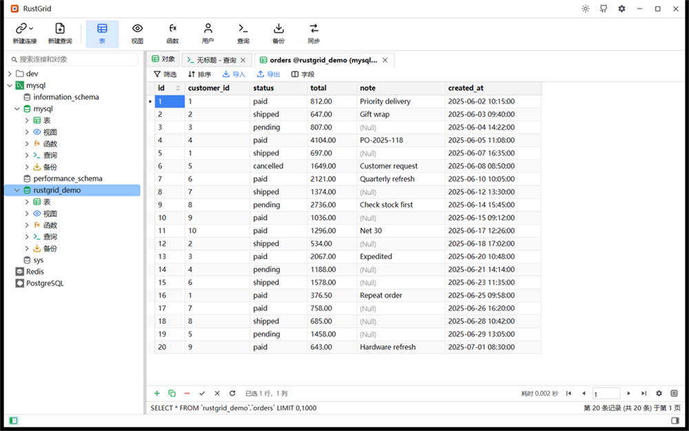

# 主界面

RustGrid 沿用 Navicat 的布局：左侧是连接树，右侧是标签页工作区，两者上方共用一个命令工具栏。熟悉这四个区域之后，所有功能模块的操作方式都是一致的。

## 界面组成

| 区域 | 作用 |
| --- | --- |
| **标题栏** | 窗口控制、主题切换、更新状态和 **选项**（齿轮）。 |
| **命令工具栏** | **新建连接**、**新建查询**，以及主标签：表、视图、函数、用户、查询、备份、同步。 |
| **连接树** | 分组与连接，展开后是数据库、模式及其对象。分组、颜色和搜索也在这里。 |
| **内容标签页** | 每个打开的对象、查询、设计器或列表都占一个标签页，可拖动、关闭和横向滚动。 |
| **状态栏** | 当前页面的连接、数据库、记录数和提示信息。 |

## 打开数据库和对象

1. 双击连接进行连接。已保存的密码会自动使用，否则弹出密码输入框。
2. 双击数据库打开它并显示表。对已经打开的数据库单击，会切换右侧对象列表，但不会折叠数据库。
3. 选中表、视图或函数后双击打开。**Enter** 打开选中对象，**F2** 就地重命名。
4. 主标签决定对象列表显示哪一类对象。支持模式的引擎（SQL Server、PostgreSQL、Oracle）会在数据库和对象之间多一层模式。

单击连接只表示选中；双击、**Enter** 或右键菜单里的 **连接** 才会真正连接，避免误连生产库。

## 主标签与内容标签

主标签是“页面”，不是“文档”。从 **表** 切到 **视图** 只会替换对象列表；打开一张表则新增一个内容标签，不会丢掉列表。

- 每个内容标签保留自己的页码、筛选、排序和选中行。
- 标签可以拖动排序；打开很多时，标签栏支持滚轮或 ◀ / ▶ 按钮滚动。
- 标签右键菜单和快捷键里都有 **关闭标签页**、**关闭其他选项卡**、**全部关闭**。
- 标签标题包含对象、数据库和连接，同名的表也能区分。

## 工作区选项

- **启动时恢复**（选项 → 常规）会在下次启动时恢复查询标签、连接、已打开的数据库和表标签。关闭后启动是干净的，连接树从折叠状态开始。
- **单击模式** 让连接、数据库和对象单击即打开；默认关闭，保持 Navicat 的双击习惯。
- **保留对象搜索** 在切换数据库时保留每个列表自己的搜索内容；点击主标签仍会清空该标签的搜索，重新进入列表时显示全部对象。

下一步可以阅读 [连接](./connections.html) 完善连接树，或直接看 [表](./tables.html) 处理数据。
